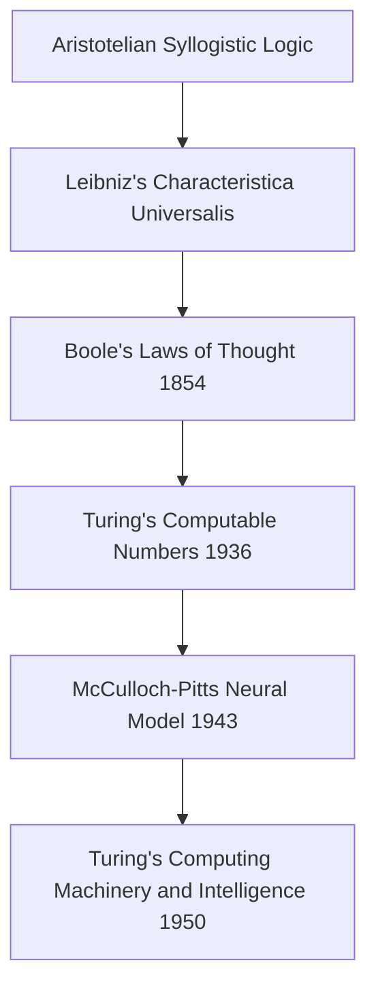
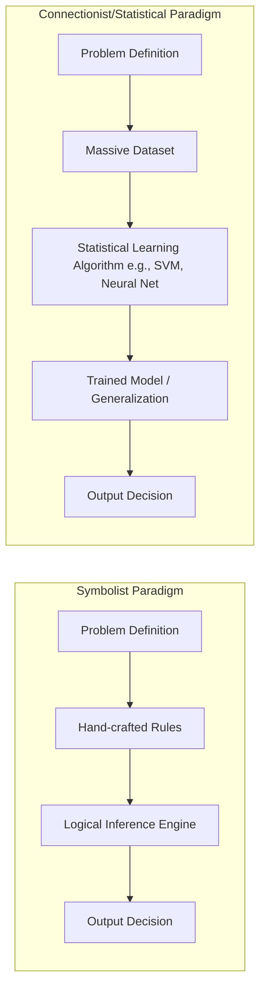

# 🤖 The Evolution of Artificial Intelligence: From Symbolic Logic to Generative Foundations

Artificial Intelligence (AI) has transitioned from a niche academic pursuit in the mid-20th century to a ubiquitous, defining technology of the 21st century. The trajectory of AI is not a steady, linear progression, but rather a series of hype-cycles defined by periods of rapid breakthroughs (AI Springs) followed by periods of disillusionment, funding cuts, and stagnation (AI Winters).

This document provides a highly detailed, comprehensive analysis of the evolution of AI, analyzing its theoretical foundations, major paradigms, historical milestones, and future outlooks.

---

## 1. Philosophical Roots and Pre-History (Pre-1956)

Long before computers existed, philosophers, mathematicians, and writers speculated about the creation of artificial minds.



### 1.1. Theoretical Foundations
*   **Formal Logic:** The quest to formalize human thought began with Aristotle's syllogisms, was advanced by Gottfried Wilhelm Leibniz's calculus ratiocinator, and was mathematically structured by George Boole’s Boolean algebra.
*   **The Turing Machine (1936):** Alan Turing introduced the concept of a universal computing machine, proving that any mathematical computation could be executed algorithmically.
*   **The McCulloch-Pitts Neuron (1943):** Warren McCulloch and Walter Pitts created a mathematical model of an artificial neuron using threshold logic, proving that networks of simplified neurons could compute any logical function.
*   **The Turing Test (1950):** In his seminal paper *"Computing Machinery and Intelligence"*, Alan Turing proposed the "Imitation Game" (Turing Test) as a practical measure of machine intelligence, bypassing the philosophical debate on whether machines can "think."

---

## 2. Chronological Breakdown of AI Eras

The history of AI can be segmented into distinct eras, characterized by shifts in dominant paradigms—from symbol-manipulation and rule-based systems to statistical models and deep neural networks.

| Era | Timeframe | Primary Paradigm | Key Breakthroughs & Milestones | Primary Constraints |
| :--- | :--- | :--- | :--- | :--- |
| **Foundational & Birth** | 1943 – 1956 | Cybernetics & Early Logic | McCulloch-Pitts Neuron; Turing Test; Dartmouth Workshop (1956) | Lack of computing hardware. |
| **The Golden Years** | 1956 – 1974 | Symbolic AI / Heuristic Search | LISP; General Problem Solver; ELIZA; Shakey the Robot | Combinatorial explosion; memory limits. |
| **First AI Winter** | 1974 – 1980 | Disillusionment & Realism | Lighthill Report (UK); ALPAC Report (US) | Severe funding cuts; scaling limitations. |
| **Expert Systems & Boom**| 1980 – 1987 | Knowledge Engineering | MYCIN; XCON; Lisp Machines; Fifth Gen Project | Brittle rules; high maintenance costs. |
| **Second AI Winter** | 1987 – 1993 | Market Collapse | Collapse of Lisp Machine market; failure of Fifth Gen | Loss of industry trust; alternative hardware. |
| **Statistical AI & ML** | 1993 – 2011 | Probabilistic Models / Data | Deep Blue beats Kasparov; SVMs; PageRank; ImageNet | Slow CPUs; lack of massive datasets. |
| **Deep Learning Era** | 2011 – 2020 | Connectionism / Deep ANNs | AlexNet (2012); AlphaGo (2016); Transformer (2017) | High energy cost; black-box nature. |
| **Generative & Foundational**| 2020 – Present | Large Language Models (LLMs) | GPT-3/4; Gemini; Claude; Diffusion models | Hallucinations; alignment; compute costs. |

---

## 3. The Birth and Golden Years of Symbolic AI (1956 – 1974)

The field of AI was officially christened at the **Dartmouth Summer Research Project on Artificial Intelligence** in 1956, organized by John McCarthy, Marvin Minsky, Nathaniel Rochester, and Claude Shannon.

### 3.1. The Symbolist Paradigm (GOFAI - Good Old-Fashioned AI)
Early AI pioneers believed that human intelligence could be replicated by manipulating symbols using formal logic and search algorithms.
*   **Logic Theorist (1956):** Developed by Allen Newell, Herbert Simon, and Cliff Shaw, this program proved 38 of the first 52 theorems in Whitehead and Russell's *Principia Mathematica*, often finding more elegant proofs than the authors.
*   **LISP (1958):** John McCarthy created LISP (List Processing), which became the dominant programming language for AI research for decades due to its capability for symbolic manipulation.
*   **ELIZA (1966):** Joseph Weizenbaum created a natural language processing program that simulated a Rogerian psychotherapist by using pattern matching and substitution rules, demonstrating the illusion of understanding.
*   **Shakey the Robot (1966–1972):** Built at SRI International, Shakey was the first general-purpose mobile robot capable of reasoning about its actions, combining computer vision, natural language processing, and path-planning algorithms (like the $A^*$ search algorithm).

---

## 4. The First AI Winter (1974 – 1980)

By the mid-1970s, the initial optimism of AI researchers collided with severe hardware and theoretical limitations.

### 4.1. The Catalysts of Decline
*   **The Lighthill Report (1973):** Commissioned by the UK Science Research Council, Professor James Lighthill evaluated the state of AI research and concluded that AI techniques had failed to solve real-world problems due to "combinatorial explosion" (where the search space grows exponentially with the complexity of the problem).
*   **The ALPAC Report (1966):** The US government-backed Automated Language Processing Advisory Committee concluded that machine translation was slower, less accurate, and more expensive than human translation, leading to the termination of translation-related funding.
*   **The Perceptrons Controversy (1969):** Marvin Minsky and Seymour Papert published *Perceptrons*, a mathematical critique of single-layer artificial neural networks (Rosenblatt's Perceptron). They proved that single-layer networks could not solve non-linearly separable functions, such as the exclusive-OR (XOR) problem. This publication effectively froze research into neural networks for nearly 15 years.

```
       [The XOR Problem in Single-Layer Perceptrons]
       
       (Input x2)
          ^
          |   1 (True)        0 (False)
          |     [o]             [*]
          |
          |     [*]             [o]
          |   0 (False)       1 (True)
          +-----------------------------> (Input x1)
          
       *Note: No single straight line (linear separator) can isolate 
       the [o] points from the [*] points, showing the failure of 
       a single-layer perceptron for non-linear operations.*
```

---

## 5. The Expert Systems Era and Second Winter (1980 – 1993)

AI returned to prominence in the 1980s through a shift in focus: instead of trying to build general-purpose thinkers, researchers created specialized systems designed to solve narrow problems in specific domains.

### 5.1. Knowledge Engineering
*   **Expert Systems:** These programs used databases of rules (if-then statements) provided by human experts to solve complex diagnostics or configuration problems.
    *   *MYCIN (1970s/80s):* Developed at Stanford, MYCIN diagnosed blood infections and recommended antibiotic treatments, performing on par with human infectious disease specialists.
    *   *XCON (1980):* Built for Digital Equipment Corporation (DEC), XCON automatically configured computer systems, saving the company millions of dollars annually.
*   **The Fifth Generation Computer Systems Project (1982):** Japan launched a massive government-funded project to develop parallel processing computers running Prolog (Logic Programming), aiming to make AI the backbone of future computing.

### 5.2. The Second Collapse (1987 – 1993)
The expert systems market crashed due to several systemic flaws:
*   **The Knowledge Acquisition Bottleneck:** It was incredibly difficult, slow, and expensive to extract rules from human experts and translate them into code.
*   **System Brittleness:** Expert systems lacked common sense; if a problem fell slightly outside the pre-programmed rules, the system failed catastrophically.
*   **Hardware Evolution:** Specialized Lisp Machines (expensive hardware optimized for AI) were rapidly outpaced in cost-performance by general-purpose microprocessors from Intel and workstation computers from Sun Microsystems, rendering the specialized AI hardware industry obsolete.

---

## 6. The Rise of Statistical Machine Learning (1993 – 2011)

As computing power grew under Moore’s Law and the Internet made massive datasets available, the AI community abandoned rule-based logic in favor of statistical and probabilistic models.

### 6.1. Paradigm Shift: Connectionism vs. Symbolism



*   **Deep Blue (1997):** IBM's chess-playing computer defeated world champion Garry Kasparov. Deep Blue relied on brute-force hardware, evaluating up to 200 million chess positions per second using heuristic evaluation functions, showcasing the power of pure computation.
*   **Probabilistic Revolution:** Algorithms like **Support Vector Machines (SVMs)**, **Random Forests**, and **Naive Bayes** became the default tools for pattern recognition, classification, and regression. Instead of codifying "what is a cat," systems were fed millions of labeled data points to learn the mathematical boundaries of a cat.
*   **The Web Era:** Search engines, spam filters, and recommendation systems (Amazon, Netflix) successfully commercialized statistical machine learning algorithms on a global scale.

---

## 7. The Deep Learning Wave (2011 – 2020)

Deep Learning is a subset of machine learning based on Deep Artificial Neural Networks (ANNs) containing many hidden layers. Its resurgence was driven by three factors: algorithmic improvements, massive datasets (Big Data), and Parallel Processing hardware (**GPUs**).

### 7.1. The AlexNet Catalyst (2012)
The modern era of Deep Learning began when **AlexNet**, a Convolutional Neural Network (CNN) developed by Alex Krizhevsky, Ilya Sutskever, and Geoffrey Hinton, won the **ImageNet Large Scale Visual Recognition Challenge** in 2012.

$$\text{Error Rate on ImageNet:} \quad 2011 \text{ (Traditional ML)} \approx 26\% \quad \longrightarrow \quad 2012 \text{ (AlexNet DL)} \approx 16\%$$

AlexNet utilized Graphics Processing Units (GPUs) to parallelize the matrix multiplications required to train deep neural networks, transforming the hardware pipeline of AI development.

### 7.2. AlphaGo (2016)
Developed by Google DeepMind, **AlphaGo** defeated legendary Go grandmaster Lee Sedol 4-1. 
*   **Why Go was difficult:** Unlike chess, Go has a branching factor too large for brute-force search. 
*   **The Architecture:** AlphaGo combined Monte Carlo Tree Search (MCTS) with deep neural networks trained via **Reinforcement Learning from Human Feedback (RLHF)** and self-play.

---

## 8. The Generative Era and Transformers (2017 – Present)

The current era is dominated by foundation models and generative AI, driven by a single revolutionary neural network architecture: the **Transformer**.

### 8.1. The Transformer Architecture (2017)
In June 2017, Vaswani et al. published the paper *"Attention Is All You Need"*, introducing the Transformer.

```
                  [The Transformer Block]
                  
                 +-----------------------+
                 |    Output Token       |
                 +-----------------------+
                             ^
                             |
                 +-----------------------+
                 | Feed-Forward Network  |
                 +-----------------------+
                             ^
                             |
                 +-----------------------+
                 | Multi-Head Attention  |  <- Computes self-attention weights
                 +-----------------------+
                             ^
                             |
                 +-----------------------+
                 |   Input Embeddings    |
                 +-----------------------+
```

*   **Self-Attention Mechanism:** Instead of processing data sequentially (like Recurrent Neural Networks/LSTMs), the Transformer processes entire sequences at once. The attention mechanism calculates mathematical relationships (weights) between every word in a sentence, allowing the model to capture long-range contextual relationships.
*   **Parallelization:** The removal of sequential processing allowed models to be trained on massive clusters of GPUs, scraping the entire public internet as training data.

### 8.2. Large Language Models (LLMs) and Generative Hype
The scaling of Transformers led to the creation of **Generative Pre-trained Transformers (GPT)** by OpenAI and similar models by Google, Anthropic, and Meta.
*   **GPT-3 (2020):** Showed emergent behaviors, demonstrating that simply scaling model size (175 billion parameters) and data size yielded general-purpose linguistic capabilities.
*   **ChatGPT (November 2022):** The release of a conversational interface fine-tuned with **Reinforcement Learning from Human Feedback (RLHF)** democratized AI access, sparking a massive global tech race.
*   **Multimodality:** Modern models process and generate not only text, but also images, audio, video, and code (e.g., GPT-4o, Gemini 1.5 Pro).

---

## 9. Architectural Evolution Reference Matrix

The following table contrasts the key paradigms of AI history across different technical axes:

| Dimension | Symbolic AI (GOFAI) | Classical Machine Learning | Deep Learning | Large Language Models (LLMs) |
| :--- | :--- | :--- | :--- | :--- |
| **Data Requirements** | None (Requires human-coded rules) | Medium (Thousands of clean, labeled tables/images) | High (Millions of labeled images or texts) | Extreme (Trillions of tokens from the entire web) |
| **Hardware Dependency** | Low (Central CPUs) | Medium (Standard CPUs/Servers) | High (Nvidia GPUs like K80/V100) | Extreme (Hyperscale GPU clusters, H100s/B200s) |
| **Explainability** | High (Traceable decision trees/rules) | Medium (Explainable statistical models) | Low (Black box, billions of floating-point weights) | Very Low (Non-deterministic, subject to hallucinations) |
| **Generalization** | Non-existent (Highly brittle) | Narrow (Fails outside the training distribution) | Medium (Robust on training domains) | High (Zero-shot/few-shot task transfer) |
| **Primary Use Cases** | Planning, mathematical proofs, scheduling | Fraud detection, search ranking, email spam filters | Computer vision, speech recognition, game playing | Text summarization, coding copilots, general reasoning |

---

## 10. Glossary of AI Evolutionary Terms

*   **1-Shot / Few-Shot Learning:** The ability of an LLM to understand and perform a task after seeing only one or a few examples in its prompt.
*   **ALPAC (Automatic Language Processing Advisory Committee):** A US committee whose 1966 report recommended stopping funding for machine translation research, triggering the First AI Winter.
*   **Aporía:** A state of logical puzzle or impasse; often used metaphorically to describe the state of AI when rules clash.
*   **Backpropagation:** The core algorithm for training neural networks, calculating the gradient of the loss function with respect to the weights to update them.
*   **Climacteric:** In biology, a critical transition state; in AI, refers to epochs where paradigm shifts (e.g., the ImageNet moment) occur.
*   **Connectionism:** An approach to AI that models mental or behavioral phenomena using networks of simple, interconnected processing units (neurons).
*   **Expert System:** A computer program that uses artificial intelligence technologies to simulate the judgment and behavior of a human that has expert knowledge in a particular field.
*   **GOFAI (Good Old-Fashioned AI):** A retronym for the symbolic, rule-based approach to artificial intelligence that dominated from the 1950s to the 1980s.
*   **LLM (Large Language Model):** A deep learning model trained on vast amounts of text data, designed to understand, generate, and process natural language.
*   **LISP:** An early, highly influential high-level programming language developed by John McCarthy, optimized for symbolic lists and AI algorithms.
*   **Mayéutica (Maieutics):** Socratic method of drawing out ideas; in AI architecture, refers to prompting techniques (like Chain of Thought) that guide the model to step-by-step reasoning.
*   **RLHF (Reinforcement Learning from Human Feedback):** A method of training AI systems where human evaluations of output quality are used as a reward signal to align model behavior.
*   **Transformer:** A deep learning model architecture introduced in 2017 that uses self-attention mechanisms to process sequence data in parallel.
*   **Turing Test:** A test of a machine's ability to exhibit intelligent behavior equivalent to, or indistinguishable from, that of a human.

## 🔗 Suggested Connections
- [[Algebraic Machine Learning: Learning as computing an]] — High semantic similarity.
- [[🏛️ Biografía Exhaustiva de Sócrates: El Padre de la Filosofía Moral]] — High semantic similarity.
- [[🏛️ The Roman Empire: An Exhaustive Historical and Structural Analysis]] — High semantic similarity.
