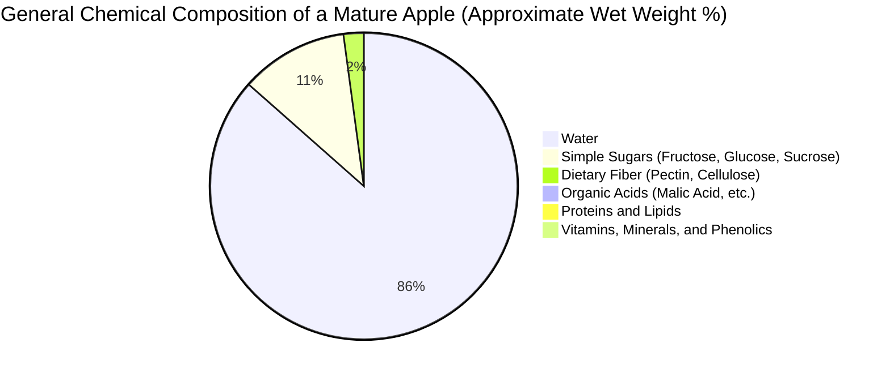
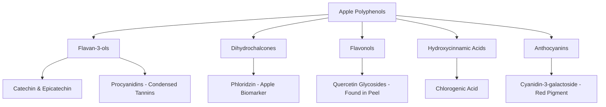
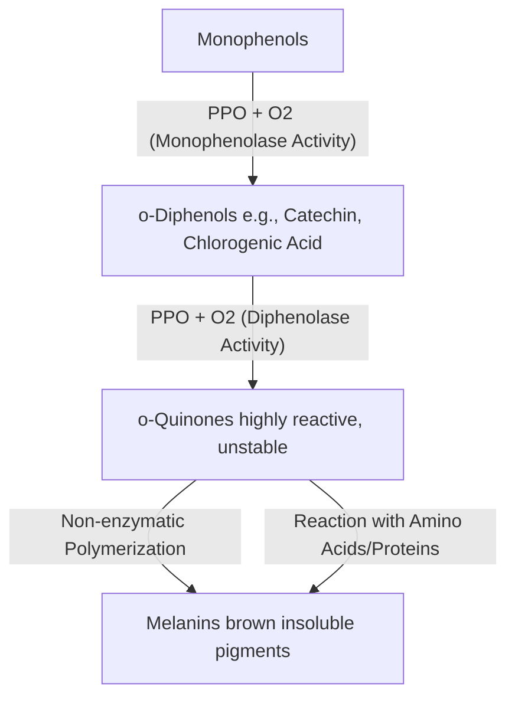

# 🍎 The Chemical Biology and Molecular Composition of Apples (*Malus domestica*)

The apple (*Malus domestica*) is one of the most widely cultivated and chemically complex temperate fruits. Its flavor, texture, color, and nutritional qualities are dictated by a delicate interplay of organic molecules, minerals, water, and enzymatic pathways. 

This document provides a highly detailed, comprehensive scientific breakdown of apple chemistry, tracing the molecules responsible for its physical properties, development, ripening, post-harvest preservation, and enzymatic reactions.

---

## 1. Macromolecular and General Chemical Composition

An apple is primarily composed of water, which acts as the solvent for a diverse matrix of carbohydrates, organic acids, mineral ions, vitamins, and secondary metabolites (phytochemicals).



### 1.1. Water and Turgor Pressure
Water accounts for approximately 84% to 86% of the fresh weight of a mature apple. 
*   **Turgor Pressure:** The water is contained within vacuoles inside the parenchymal cells. This water exerts hydrostatic pressure against the semi-rigid cellulose cell walls. This internal pressure, known as turgor pressure, is chemically responsible for the crispness and crunchiness of the fruit.
*   **Loss of Turgor:** As water evaporates post-harvest, or as cell membranes lose their selective permeability during senescence, turgor pressure drops, resulting in a soft, mealy, or flaccid texture.

---

## 2. Carbohydrate Chemistry: Sugars, Starches, and Fiber

Carbohydrates are the most abundant dry matter components in apples, determining both the sweetness profile and the structural framework of the fruit tissue.

### 2.1. Sugar Profile and Sweetness Perception
During fruit development, apples accumulate starch, which is enzymatically hydrolyzed into simple sugars as the fruit ripens. The main soluble sugars are **Fructose**, **Glucose**, and **Sucrose**, alongside the sugar alcohol **Sorbitol**.

| Sugar Type | Molecular Formula | Relative Sweetness (Sucrose = 1.0) | Percentage of Total Soluble Sugars | Metabolic Role |
| :--- | :--- | :--- | :--- | :--- |
| **Fructose** | $C_6H_{12}O_6$ (Hexose) | 1.2 – 1.8 (Temperature dependent) | 50% – 60% | Primary source of sweetness; accumulated via vacuolar invertase. |
| **Glucose** | $C_6H_{12}O_6$ (Hexose) | 0.7 – 0.8 | 15% – 20% | Direct product of starch breakdown; cellular respiration fuel. |
| **Sucrose** | $C_{12}H_{22}O_{11}$ (Disaccharide) | 1.0 | 10% – 20% | Transport sugar synthesized in leaves and translocated to fruit. |
| **Sorbitol** | $C_6H_{14}O_6$ (Polyol) | 0.6 | 3% – 8% | Main photosynthetic transport carbohydrate in Rosaceae family. |

The high ratio of fructose to glucose is chemically significant because fructose has a lower glycemic index than glucose and tastes sweeter at cooler temperatures, which defines the refreshing sensory profile of cold apples.

### 2.2. Structural Carbohydrates (Dietary Fiber)
The structural integrity of the apple is maintained by three primary cell wall polymers:
1.  **Cellulose:** A linear polymer of $\beta(1\rightarrow4)$-D-glucan units forming crystalline microfibrils that provide tensile strength.
2.  **Hemicellulose (primarily Xyloglucan):** Cross-links cellulose microfibrils, stabilizing the cell wall network.
3.  **Pectins (Homogalacturonan and Rhamnogalacturonan):** Complex branched polysaccharides rich in D-galacturonic acid. Pectin forms a hydrated gel in the middle lamella, acting as the cellular "glue" holding adjacent plant cells together.

```
          [Simplified Model of Apple Cell Wall Structure]
          
     +-----------------------------------------------------+
     |               Cellulose Microfibrils                |
     |    =============================================    |
     |          \   /                       \   /          |  <- Hemicellulose Cross-links
     |     ------\-/-------------------------\-/------     |
     |            X                           X            |
     |      .........................................      |  <- Pectin Gel Matrix (Middle Lamella)
     |      .........................................      |
     +-----------------------------------------------------+
```

During ripening, enzymes like **polygalacturonase (PG)** and **pectinesterase (PE)** break down pectin polymers, solubilizing the middle lamella. This chemically leads to the softening of the fruit.

---

## 3. Organic Acids, pH, and Flavor Balance

The acidity of an apple is a key determinant of its taste profile, balance, and preservation properties.

### 3.1. Malic Acid: The Dominant Organic Acid
Over 90% of the total organic acid content in apples consists of **L-malic acid** ($C_4H_6O_5$), a dicarboxylic acid synthesized in the cytosol of fruit cells and stored in large quantities within the vacuoles.

```
       HO-CH-COOH
       |
       CH2-COOH
   [L-Malic Acid Chemical Structure]
```

*   **Synthesis:** Malic acid is synthesized via the carboxylation of phosphoenolpyruvate (PEP) to oxaloacetate (OAA) by PEP carboxylase, followed by reduction to malate by cytosolic malate dehydrogenase.
*   **Degradation:** During ripening and post-harvest storage, malic acid is consumed as a respiratory substrate via the tricarboxylic acid (TCA) cycle. This causes the total acidity of the apple to decrease over time.
*   **pH Level:** The typical pH of apple juice ranges from **3.0 to 4.0**, depending on the cultivar. Cultivars like 'Granny Smith' contain high concentrations of malic acid, maintaining a low pH (~3.0–3.2), whereas 'Red Delicious' has low malic acid levels, resulting in a higher pH (~3.8–4.0).

### 3.2. Minor Organic Acids
Apples also contain trace amounts of other organic acids:
*   **Quinic Acid:** Contributes to astringency.
*   **Citric Acid:** Present in very low amounts compared to citrus fruits.
*   **Ascorbic Acid (Vitamin C):** Functions as a critical antioxidant, though its levels vary drastically across cultivars (ranging from 3 to 30 mg/100g).

---

## 4. Phenolic Compounds (Polyphenols) and Color Chemistry

Apples are rich in secondary metabolites called polyphenols. These compounds are responsible for the fruit’s astringency, bitterness, browning reactions, color, and antioxidant benefits.



### 4.1. Major Polyphenol Classes in Apples

#### 1. Flavan-3-ols (Monomers and Oligomers)
*   **Compounds:** (-)-Epicatechin and (+)-Catechin (monomers); Procyanidins (oligomers/polymers).
*   **Role:** Procyanidins, also known as condensed tannins, are responsible for the astringency of the fruit. They bind to and precipitate salivary proteins in the mouth, creating a drying sensation. High concentrations are preferred in cider apples.

#### 2. Dihydrochalcones
*   **Compounds:** **Phloridzin** (Phloretin-2'-O-glucoside).
*   **Role:** Phloridzin is a chemical biomarker unique to the genus *Malus*. It acts as a natural inhibitor of sodium-glucose cotransporters (SGLT1 and SGLT2) and plays a role in disease resistance in the tree.

#### 3. Flavonols
*   **Compounds:** Quercetin glycosides (rutinoside, glucoside, galactoside, rhamnoside).
*   **Role:** Almost exclusively located in the apple skin (peel) because their biosynthesis is stimulated by sunlight (UV radiation). They act as natural UV filters to protect the fruit tissue.

#### 4. Hydroxycinnamic Acids
*   **Compounds:** Chlorogenic acid (5-caffeoylquinic acid).
*   **Role:** The most abundant phenolic compound in the apple flesh. It serves as the primary substrate for enzymatic browning.

#### 5. Anthocyanins
*   **Compounds:** **Cyanidin-3-galactoside**.
*   **Role:** Water-soluble pigments responsible for the red and purple colors of apple skin. Their accumulation is dependent on low night temperatures, high sunlight, and ethylene levels, which trigger the expression of anthocyanin biosynthesis genes.

---

## 5. The Chemistry of Enzymatic Browning

When an apple is cut, bruised, or bitten, its tissues brown rapidly. This is a complex biochemical defense mechanism against pathogens and pests.

### 5.1. The Enzymatic Browning Pathway
The reaction requires three components: **oxygen ($O_2$)**, **phenolic substrates (specifically o-diphenols)**, and the enzyme **Polyphenol Oxidase (PPO)**.



1.  **Monophenolase Activity (Cresolase activity):** PPO catalyzes the hydroxylation of monophenols to *o*-diphenols.
2.  **Diphenolase Activity (Catecholase activity):** PPO oxidizes *o*-diphenols to highly reactive *o*-quinones.
3.  **Non-Enzymatic Polymerization:** The *o*-quinones, which are electrophilic, rapidly react with other quinones, amino acids, and proteins. They undergo non-enzymatic polymerization to form **melanins**, which are complex brown, insoluble nitrogenous pigments.

### 5.2. Chemical Inhibition of Browning
To prevent enzymatic browning in food processing, the PPO enzyme must be denatured, or the chemical reactants must be controlled:

*   **pH Manipulation (Acidulation):** PPO has an optimum pH of 6.0–7.0. Adding citric or ascorbic acid to lower the pH below 3.0 denatures the enzyme and chelates the copper cofactors at its active site.
*   **Reducing Agents (Ascorbic Acid):** Ascorbic acid reduces the reactive *o*-quinones back to colorless *o*-diphenols before they can polymerize into melanins. Once all ascorbic acid is oxidized to dehydroascorbic acid, browning resumes.
*   **Oxygen Exclusion:** Immersing cut apples in water or vacuum-sealing them prevents gaseous $O_2$ from participating in the PPO reaction.
*   **Thermal Denaturation:** Blanching (short exposure to temperatures above 70°C) permanently denatures the tertiary structure of the PPO protein.
*   **Genetically Modified Inhibition:** Cultivars like "Arctic Apples" utilize polyphenol oxidase gene silencing (RNA interference) to reduce PPO production to near-zero levels, preventing browning without chemical additives.

---

## 6. Volatile Organic Compounds (VOCs) and Aroma Chemistry

The distinct aroma and flavor of an apple are not determined by a single molecule, but by a complex mixture of over 300 volatile organic compounds, dominated by esters, alcohols, and aldehydes.

### 6.1. Key Volatile Compounds and Odor Descriptors

| Compound Class | Specific Compound | Chemical Formula | Aroma / Odor Descriptor | Presence in Varieties |
| :--- | :--- | :--- | :--- | :--- |
| **Esters** | **Butyl acetate** | $C_6H_{12}O_2$ | Sweet, fruity, classic ripe apple note. | High in ripe 'Golden Delicious'. |
| **Esters** | **2-Methylbutyl acetate** | $C_7H_{14}O_2$ | Intense banana-apple fruitiness. | Ripe apples, 'Gala', 'Fuji'. |
| **Esters** | **Hexyl acetate** | $C_8H_{16}O_2$ | Fruity, sweet, pear-like. | Found in most commercial red apples. |
| **Aldehydes** | **hexanal** | $C_6H_{12}O$ | Green, grassy, leafy. | High in unripe apples. |
| **Aldehydes** | **trans-2-hexenal** | $C_6H_{10}O$ | Sharp, fresh, green apple skin. | Primary aroma of 'Granny Smith'. |
| **Alcohols** | **2-methyl-1-butanol** | $C_5H_{12}O$ | Wine-like, sweet, alcoholic. | Overripe apples. |

### 6.2. Ethylene Biosynthesis and Ripening Chemistry
Apples are **climacteric fruits**, meaning their ripening process is accompanied by a dramatic surge in respiration rate and a burst of the plant hormone **ethylene** ($C_2H_4$). 

Ethylene synthesis follows the **Yang Cycle** (methionine pathway):

$$\text{Methionine} \xrightarrow{\text{S-Adenosylmethionine (SAM)}} \xrightarrow{\text{ACC Synthase (ACS)}} \text{1-Aminocyclopropane-1-carboxylic acid (ACC)} \xrightarrow{\text{ACC Oxidase (ACO)}} \text{Ethylene } (C_2H_4)$$

Ethylene binds to receptors in the cell membrane, triggering a signal transduction cascade that upregulates genes responsible for:
*   Starch hydrolysis (amylase enzymes).
*   Chlorophyll degradation (unmasking carotenoids and anthocyanins).
*   Cell wall softening (pectin-degrading enzymes).
*   Volatile ester synthesis (alcohol acyltransferase).

---

## 7. Post-Harvest Preservation and Storage Chemistry

Because apples are harvested seasonally but consumed year-round, chemical methods are employed to slow down their respiration and senescence.

```
       [Climacteric Respiration and Ripening Control]
       
       Respiration / Ethylene Burst
            ^             * (Ripening peak)
            |            / \
            |           /   \
            |          /     \
            |   ______/       \_______ (Senescence)
            +---------------------------------------------> Time
              ^
              |-- [1-MCP Application stops this curve by blocking receptors]
```

### 7.1. Controlled Atmosphere (CA) Storage
CA storage rooms prolong apple shelf-life up to 12 months by altering the atmospheric gas concentrations:
*   **Oxygen Reduction:** Atmospheric $O_2$ is reduced from ~21% to **1.0% – 2.0%**. This limits the rate of aerobic respiration, slowing down the consumption of sugars and malic acid.
*   **Carbon Dioxide Enrichment:** $CO_2$ is increased from ~0.04% to **1.0% – 3.0%**. High $CO_2$ acts as a competitive inhibitor of ethylene action and reduces respiratory enzyme activity.

### 7.2. 1-Methylcyclopropene (1-MCP) Action
Sold commercially as *SmartFresh*, **1-MCP** ($C_4H_6$) is a gaseous synthetic cyclopropene derivative.
*   **Mechanism:** 1-MCP binds irreversibly to ethylene receptors (ETR1 and others) on the cell membrane, blocking ethylene from binding.
*   **Result:** The fruit does not receive the signal to ripen, maintaining firmness, acidity, and color for extended periods, even after removal from cold storage.

---

## 8. Nutritional and Mineral Chemistry

Apples are a source of trace minerals and vitamins that interact to support both human health and fruit development.

### 8.1. Mineral Interactions in Apple Physiology
The structural health of the apple during growth and storage depends heavily on its mineral balance:

*   **Calcium ($Ca^{2+}$):** Critical for cell wall stability. Ionic calcium cross-links the negatively charged carboxyl groups of de-esterified pectins in the middle lamella, creating a stable gel network (often called the "egg-box" model). 
    *   *Deficiency:* Low calcium levels lead to **Bitter Pit**, a physiological disorder characterized by localized cell collapse and brown, bitter corky spots under the skin.
*   **Potassium ($K^+$):** Serves as the primary osmoticum regulating cell expansion and turgor pressure. High K/Ca ratios increase susceptibility to storage disorders.
*   **Boron ($B$):** Works synergistically with calcium in cell wall synthesis and cell division.

---

## 9. Chemical Composition Reference Table

The following table summarizes the typical concentrations of key chemical constituents found in a fresh, whole apple (flesh and skin combined):

| Chemical Constituent | Average Concentration per 100g Fresh Weight | Analytical Role / Function | Key Chemical Properties |
| :--- | :--- | :--- | :--- |
| **Water** | 85.5 g | Solvent & Turgor medium. | High heat capacity, hydrogen bonding network. |
| **Fructose** | 5.9 g | Sweetness. | Ketose sugar; highly soluble. |
| **Glucose** | 2.4 g | Energy. | Aldose sugar; directly fermentable by yeast. |
| **Sucrose** | 2.1 g | Translocation sugar. | Non-reducing disaccharide. |
| **Pectin** | 0.5 – 1.0 g | Gelling agent & dietary fiber. | Polygalacturonic acid backbone, variable methylation. |
| **Cellulose & Hemicellulose** | 1.0 – 1.5 g | Insoluble dietary fiber. | Crystalline $\beta(1\rightarrow4)$ glycosidic linkages. |
| **Malic Acid** | 0.4 – 1.2 g | Tartness / Sourness. | Dicarboxylic acid; participates in TCA cycle. |
| **Potassium ($K^+$)** | 107 mg | Osmotic balance / Nerve function. | Monovalent cation; highly mobile in phloem. |
| **Vitamin C (Ascorbic Acid)** | 4.6 mg | Antioxidant. | Reducing agent; sensitive to heat and oxygen. |
| **Total Polyphenols** | 100 – 200 mg | Astringency & Browning substrate. | Phenol rings with multiple hydroxyl groups. |
| **Phloridzin** | 5 – 20 mg | Genus-specific biomarker. | Dihydrochalcone glucoside; SGLT inhibitor. |

---

## 10. Glossary of Chemical and Botanical Terms

*   **1-MCP (1-Methylcyclopropene):** A gaseous synthetic plant growth regulator that inhibits ethylene action by binding to ethylene receptors.
*   **Anthocyanins:** Water-soluble vacuolar pigments that appear red, purple, or blue depending on the pH.
*   **Climacteric:** A stage of fruit ripening associated with an increase in respiration and ethylene production.
*   **Dihydrochalcone:** A subclass of flavonoids unique to certain plant families, characterized by the absence of a C-ring.
*   **Enzymatic Browning:** A chemical process involving polyphenol oxidase, oxygen, and phenolic compounds, resulting in melanins.
*   **Fructose:** A simple ketose monosaccharide found in fruits; isomer of glucose.
*   **Malic Acid:** A dicarboxylic acid that gives apples their tart taste.
*   **Middle Lamella:** A pectin-rich intercellular layer that glues adjacent plant cells together.
*   **Pectin:** A structural heteropolysaccharide contained in the primary cell walls of terrestrial plants.
*   **Phloridzin:** A specific glycoside of phloretin found in apple trees, serving as a chemical marker.
*   **Polyphenol Oxidase (PPO):** A copper-containing enzyme that catalyzes the oxidation of phenols to quinones.
*   **Turgor Pressure:** The pressure of water inside the plant cell vacuole pushing against the cell wall.
*   **Yang Cycle:** The metabolic pathway responsible for the biosynthesis of ethylene from methionine.

## 🔗 Suggested Connections
- [[🐸 Biología de las Ranas: Un Análisis Exhaustivo de los Anuros]] — High semantic similarity.
- [[🌌 Astronomía General: Del Sistema Solar a la Cosmología Física]] — High semantic similarity.
- [[🏛️ The Roman Empire: An Exhaustive Historical and Structural Analysis]] — High semantic similarity.
