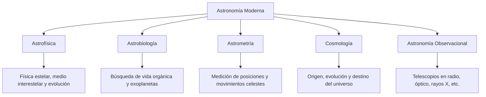
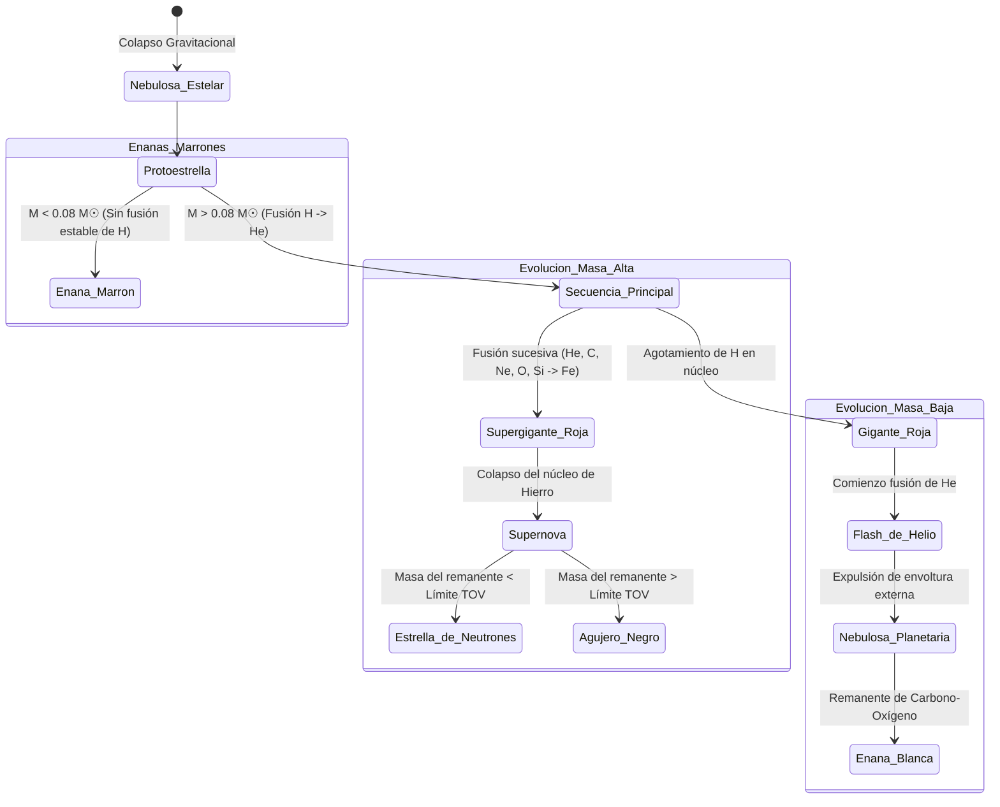
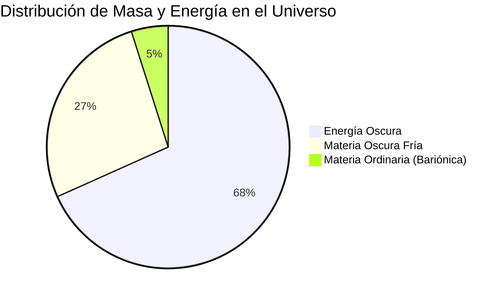

# 🌌 Astronomía General: Del Sistema Solar a la Cosmología Física

La astronomía es la ciencia natural que estudia los cuerpos celestes del universo, incluidos los planetas, satélites, estrellas, galaxias, medio interestelar y la estructura del cosmos a gran escala. A lo largo de la historia humana, la astronomía ha evolucionado de ser una disciplina de observación a simple vista orientada a la navegación y el cómputo del tiempo, a convertirse en una rama rigurosa de la física molecular, termodinámica y cosmología teórica.

Este documento ofrece un compendio técnico y estructurado de los principios astronómicos, astrofísicos y cosmológicos que rigen nuestro universo.

---

## 1. Ramas de la Astronomía y Unidades de Medida

La astronomía moderna es inherentemente interdisciplinaria y se divide en varios campos de especialización teórica y observacional.



### 1.1. Unidades de Medida en el Espacio
Debido a las escalas colosales del cosmos, las unidades de medida terrestres (como el metro o el kilómetro) son imprácticas. La astronomía utiliza las siguientes unidades estándar:

*   **Unidad Astronómica (UA):** Representa la distancia media entre la Tierra y el Sol.
    $$1 \text{ UA} \approx 149,597,870.7 \text{ km} \approx 8.3 \text{ minutos luz}$$
*   **Año Luz (al):** La distancia que recorre un fotón en el vacío durante un año juliano.
    $$1 \text{ al} \approx 9.46 \times 10^{12} \text{ km} \approx 63,241 \text{ UA}$$
*   **Pársec (pc):** Abreviatura de *paralaje de un segundo de arco*. Es la distancia a la que una estrella tendría un paralaje de exactamente un segundo de arco bajo el movimiento orbital de la Tierra.
    $$1 \text{ pc} \approx 3.2616 \text{ al} \approx 3.0857 \times 10^{13} \text{ km} \approx 206,265 \text{ UA}$$

---

## 2. Las Leyes del Movimiento Celeste

La transición del modelo geocéntrico ptolemaico al modelo heliocéntrico copernicano fue consolidada por Johannes Kepler y Galileo Galilei a principios del siglo XVII.

### 2.1. Las Tres Leyes de Kepler
Kepler dedujo que las órbitas de los planetas no eran círculos perfectos, sino elipses, formulando tres leyes fundamentales:

1.  **Primera Ley (Ley de las Órbitas):** Todos los planetas se desplazan alrededor del Sol siguiendo órbitas elípticas, con el Sol situado en uno de los focos de la elipse.
2.  **Segunda Ley (Ley de las Áreas):** La línea imaginaria (radio vector) que une a un planeta con el Sol barre áreas iguales en tiempos iguales. Como consecuencia, la velocidad orbital de los planetas es variable (máxima en el *perihelio* y mínima en el *afelio*).
3.  **Tercera Ley (Ley de los Periodos):** El cuadrado del periodo orbital ($P$) de un planeta es directamente proporcional al cubo del semieje mayor ($a$) de su órbita.
    $$P^2 \propto a^3 \quad \longrightarrow \quad \frac{P^2}{a^3} = \text{constante}$$

---

## 3. El Sistema Solar: Composición y Dinámica

El Sistema Solar se compone de una estrella central (el Sol), ocho planetas principales divididos en dos categorías, planetas enanos y millones de cuerpos menores (asteroides y cometas).

### 3.1. Tabla Comparativa de los Planetas del Sistema Solar

| Planeta | Clasificación | Distancia al Sol (UA) | Masa (Tierra = 1.0) | Radio Ecuatorial (Tierra = 1.0) | Satélites Naturales | Temperatura Superficial Media |
| :--- | :--- | :--- | :--- | :--- | :--- | :--- |
| **Mercurio** | Terrestre / Rocoso | 0.39 | 0.055 | 0.383 | 0 | 167 °C (-180 °C a 430 °C) |
| **Venus** | Terrestre / Rocoso | 0.72 | 0.815 | 0.949 | 0 | 464 °C (Efecto invernadero desbocado) |
| **Tierra** | Terrestre / Rocoso | 1.00 | 1.000 | 1.000 | 1 (Luna) | 15 °C |
| **Marte** | Terrestre / Rocoso | 1.52 | 0.107 | 0.532 | 2 (Fobos, Deimos) | -65 °C |
| **Júpiter** | Gigante Gaseoso | 5.20 | 317.8 | 11.21 | 95 | -110 °C |
| **Saturno** | Gigante Gaseoso | 9.58 | 95.2 | 9.45 | 146 | -140 °C |
| **Urano** | Gigante Helado | 19.20 | 14.5 | 4.01 | 28 | -195 °C |
| **Neptuno** | Gigante Helado | 30.05 | 17.1 | 3.88 | 16 | -200 °C |

### 3.2. Cuerpos Menores y Zonas Periféricas
*   **Cinturón de Asteroides:** Región situada entre Marte y Júpiter poblada por millones de cuerpos rocosos y carbonáceos. Contiene al planeta enano Ceres.
*   **Cinturón de Kuiper:** Anillo de objetos transneptunianos congelados que se extiende más allá de Neptuno (30 a 50 UA). Es el origen de los cometas de periodo corto y alberga a Plutón, Eris, Haumea y Makemake.
*   **Nube de Oort:** Nube esférica hipotética de cometas y cuerpos helados situada a casi 1 año luz del Sol (hasta 100,000 UA). Marca los límites gravitacionales del Sistema Solar.

---

## 4. Astrofísica Estelar: Vida, Estructura y Muerte de las Estrellas

Las estrellas son reactores de fusión nuclear autogravitantes en equilibrio térmico e hidrostático. La astrofísica estelar estudia las leyes físicas que gobiernan su estructura interna, la generación de energía en sus núcleos y los procesos que determinan su evolución temporal.

### 4.1. Ecuaciones Fundamentales de Estructura Estelar
El interior de una estrella se modela físicamente utilizando un conjunto de ecuaciones diferenciales que describen el equilibrio hidrostático, la conservación de la masa, la conservación de la energía y el transporte de energía (por radiación o convección).

1. **Equilibrio Hidrostático:** Expresa que el gradiente de presión hacia afuera equilibra exactamente la fuerza de gravedad dirigida hacia el centro.
   $$\frac{dP}{dr} = -\frac{G M(r) \rho(r)}{r^2}$$
   Donde $P(r)$ es la presión a la distancia radial $r$, $\rho(r)$ es la densidad del gas y $M(r)$ es la masa acumulada dentro de la esfera de radio $r$.

2. **Conservación de la Masa:**
   $$\frac{dM}{dr} = 4\pi r^2 \rho(r)$$

3. **Conservación de la Energía (Equilibrio Térmico):**
   $$\frac{dL}{dr} = 4\pi r^2 \rho(r) \epsilon(r)$$
   Donde $L(r)$ es la luminosidad generada y $\epsilon(r)$ es la tasa de generación de energía por unidad de masa.

4. **Transporte de Energía por Radiación:** Si la energía se transporta por fotones, el gradiente de temperatura es:
   $$\frac{dT}{dr} = -\frac{3 \kappa(r) \rho(r) L(r)}{16 \pi a c r^2 T(r)^3}$$
   Donde $\kappa(r)$ es la opacidad media de Rosseland, $a$ es la constante de densidad de radiación y $c$ es la velocidad de la luz. Si el gradiente radiativo es inestable (según el Criterio de Schwarzschild), la energía se transporta por **convección** (movimientos macroscópicos de plasma).

---

### 4.2. Procesos de Fusión Nuclear (Nucleosíntesis Estelar)
Las estrellas brillan gracias a la liberación de energía mediante la fusión de núcleos ligeros en núcleos más pesados. La fusión solo ocurre en el núcleo, donde las temperaturas superan los $10^7 \text{ K}$, permitiendo que los protones superen la repulsión electrostática (barrera de Coulomb) mediante el **efecto túnel cuántico**.

#### A. La Cadena Protón-Protón (p-p)
Es la fuente de energía dominante para estrellas con masas similares al Sol ($M \le 1.3 M_\odot$). Transforma cuatro protones en un núcleo de Helio-4 ($^4\text{He}$), liberando un 0.7% de la masa inicial en forma de energía ($E=\Delta m \cdot c^2$):

$$\text{Paso 1: } p + p \rightarrow ^2\text{H} + e^+ + \nu_e \quad (\text{Tasa muy lenta, limita la vida de la estrella})$$
$$\text{Paso 2: } ^2\text{H} + p \rightarrow ^3\text{He} + \gamma$$
$$\text{Paso 3 (Rama p-p I): } ^3\text{He} + ^3\text{He} \rightarrow ^4\text{He} + 2p$$

#### B. El Ciclo CNO (Carbono-Nitrógeno-Oxígeno)
Para estrellas más masivas ($M > 1.3 M_\odot$), la temperatura del núcleo es superior a $1.5 \times 10^7 \text{ K}$. El ciclo CNO utiliza núcleos de $^{12}\text{C}$ como catalizador para fusionar hidrógeno en helio. La tasa de generación de energía en el ciclo CNO es extremadamente sensible a la temperatura ($\epsilon_{\text{CNO}} \propto T^{17}$ frente a $\epsilon_{\text{pp}} \propto T^4$).

#### C. El Proceso Triple Alfa
Cuando el hidrógeno del núcleo se agota en las estrellas evolucionadas y la temperatura alcanza los $10^8 \text{ K}$, comienza la fusión de Helio en Carbono:

$$^4\text{He} + ^4\text{He} \leftrightarrow ^8\text{Be}$$
$$^8\text{Be} + ^4\text{He} \rightarrow ^{12}\text{C} + \gamma$$
*Nota: Debido a que el Berilio-8 es muy inestable (vida media de $10^{-16}\text{ s}$), esta reacción requiere que la colisión con la tercera partícula alfa ocurra casi instantáneamente, un proceso de resonancia cuántica predicho por Fred Hoyle.*

---

### 4.3. El Ciclo de Vida Estelar y Límites de Masa
La evolución de una estrella depende de su masa inicial al nacer dentro de una nebulosa.



#### Límites Físicos de Masa Estelar:
*   **Límite de Hayashi / Kumar ($\sim 0.08 M_\odot$):** Por debajo de este límite de masa, la presión de degeneración electrónica en el núcleo detiene el colapso gravitatorio antes de que la temperatura central alcance el punto de ignición del hidrógeno. El objeto resultante es una **enana marrón** (estrella fallida).
*   **Límite de Eddington:** El límite superior de masa donde la presión de la radiación hacia afuera supera la atracción gravitacional hacia adentro. Para estrellas típicas, este límite ronda las **$150 - 300 M_\odot$**. Si se supera, la estrella expulsa violentamente sus capas externas.

---

### 4.4. Clasificación Espectral y el Diagrama H-R
Las estrellas se clasifican según sus espectros ópticos de absorción, que reflejan su temperatura superficial. El orden tradicional de caliente a frío es **O, B, A, F, G, K, M**.

| Clase Espectral | Color | Temperatura Superficial (K) | Líneas Espectrales Clave | Ejemplo de Estrella |
| :--- | :--- | :--- | :--- | :--- |
| **O** | Azul | > 30,000 K | Helio ionizado (He II), Nitrógeno ionizado. | Alnitak (Orion) |
| **B** | Azul-Blanco | 10,000 – 30,000 K | Helio neutro (He I), Hidrógeno. | Rigel |
| **A** | Blanco | 7,500 – 10,000 K | Líneas muy fuertes de Hidrógeno (serie de Balmer). | Sirio, Vega |
| **F** | Blanco-Amarillo | 6,000 – 7,500 K | Metales ionizados (Hierro, Calcio II). | Procyon |
| **G** | Amarillo | 5,200 – 6,000 K | Calcio II ionizado (líneas H y K), metales neutros. | El Sol, Alfa Centauri A |
| **K** | Naranja | 3,700 – 5,200 K | Metales neutros, óxido de titanio. | Arcturus, Aldebarán |
| **M** | Rojo | < 3,700 K | Bandas fuertes de óxido de titanio (TiO). | Betelgeuse, Próxima Centauri |

El **Diagrama de Hertzsprung-Russell (H-R)** grafica la Luminosidad absoluta de las estrellas frente a su clase espectral/temperatura. La mayoría de las estrellas activas se ubican en la franja diagonal conocida como la **Secuencia Principal**.

---

### 4.5. Remanentes Estelares y Física de la Degeneración
Cuando el combustible nuclear se agota, las estrellas colapsan bajo su propia gravedad, dando origen a remanentes estelares compactos cuya estabilidad está descrita por la mecánica cuántica y la relatividad general.

#### A. Enanas Blancas y el Límite de Chandrasekhar
Las estrellas de masa baja e intermedia expulsan sus envolturas y dejan un núcleo inerte de Carbono y Oxígeno. Este núcleo colapsa hasta que la gravedad es equilibrada por la **presión de degeneración de los electrones**, una presión de origen cuántico resultante del Principio de Exclusión de Pauli (dos electrones no pueden ocupar el mismo estado cuántico).
*   **Límite de Chandrasekhar ($M \approx 1.4 M_\odot$):** Es la masa máxima que puede soportar la presión de degeneración de electrones no relativistas. Si el núcleo de la enana blanca supera este límite (por acreción en un sistema binario), colapsa violentamente, desencadenando una **Supernova Tipo Ia**.

#### B. Estrellas de Neutrones y el Límite TOV
Las estrellas masivas experimentan el colapso del núcleo de hierro en una supernova. La gravedad extrema vence la presión de degeneración de electrones, forzando a los protones y electrones a combinarse mediante captura electrónica ($p + e^- \rightarrow n + \nu_e$). El remanente resultante se estabiliza por la **presión de degeneración de neutrones**.
*   **Límite de Tolman-Oppenheimer-Volkoff (TOV) ($M \approx 2.17 - 3 M_\odot$):** Es la masa límite que puede soportar una estrella de neutrones fría antes de colapsar. Si la masa remanente supera este límite, no existe ninguna fuerza física conocida que pueda detener el colapso gravitacional, dando origen a un **agujero negro**.

---

## 5. Galaxias y Estructura a Gran Escala del Universo

Las estrellas no se distribuyen al azar, sino que se agrupan en galaxias, que a su vez forman cúmulos y supercúmulos separados por vacíos cósmicos.

### 5.1. La Clasificación de Secuencia de Hubble
Edwin Hubble propuso un esquema morfológico (el "diagrama de diapasón") para clasificar las galaxias:

*   **Galaxias Elípticas (E0 a E7):** Tienen formas esféricas u ovoides. Contienen estrellas viejas, poca materia interestelar y baja tasa de formación estelar.
*   **Galaxias Espirales (Sa, Sb, Sc):** Poseen un bulbo central, un disco plano y brazos espirales ricos en gas y estrellas jóvenes. La Vía Láctea es una espiral barrada (SBb).
*   **Galaxias Lenticulares (S0):** Estado intermedio entre elípticas y espirales, con disco pero sin brazos espirales definidos.
*   **Galaxias Irregulares (Irr):** Formas caóticas causadas por interacciones gravitacionales o colisiones (ej. las Nubes de Magallanes).

```
                 [La Secuencia de Hubble en Diapasón]
                 
                              +---> Espirales Normales (Sa -> Sb -> Sc)
                             /
       Elípticas (E0 -> E7) +---> Lenticulares (S0)
                             \
                              +---> Espirales Barradas (SBa -> SBb -> SBc)
```

---

## 6. Cosmología Física y el Destino del Universo

La cosmología estudia la dinámica global del universo, su origen y su evolución temporal.

### 6.1. La Expansión del Espacio y la Ley de Hubble-Lemaître
En la década de 1920, Edwin Hubble y Georges Lemaître descubrieron que la luz de las galaxias lejanas sufría un corrimiento al rojo (*redshift*), lo que indicaba que se alejaban de nosotros. La velocidad de recesión ($v$) es proporcional a la distancia ($d$) de la galaxia:

$$v = H_0 \cdot d$$

Donde $H_0$ es la **Constante de Hubble**, actualmente estimada entre **67 y 73 km/s/Mpc**. Esto demostró que el universo se está expandiendo.

### 6.2. El Modelo Estándar de la Cosmología ($\Lambda\text{-CDM}$)
El modelo dominante hoy en día sostiene que el universo se compone principalmente de componentes invisibles:

*   **Energía Oscura ($\Lambda$):** Representa aproximadamente el **68.3%** del universo. Es una fuerza repulsiva que acelera la expansión del espacio. Se modela como la constante cosmológica de Einstein.
*   **Materia Oscura Fría (CDM):** Constituye el **26.8%**. Materia no bariónica e invisible que solo interactúa mediante la gravedad, manteniendo unidas a las galaxias.
*   **Materia Bariónica (Ordinaria):** Apenas el **4.9%** de la masa-energía del universo (estrellas, planetas, gas, polvo y seres vivos).



### 6.3. El Big Bang y la Radiación de Fondo de Microondas (CMB)
La expansión del universo implica que, en el pasado, el cosmos era denso y caliente. Hace aproximadamente **13,800 millones de años**, el universo observable surgió de una singularidad espacio-temporal.

*   **La Era de Recombinación (380,000 años después del Big Bang):** La temperatura cayó lo suficiente (~3,000 K) para que los electrones libres se acoplaran con los protones para formar átomos de hidrógeno neutro. El universo se volvió transparente a los fotones.
*   **El CMB:** Esos primeros fotones liberados se han estirado por la expansión del espacio hasta el espectro de microondas (temperatura equivalente de **2.725 K**), siendo la prueba más directa de la teoría del Big Bang.

---

## 7. Instrumentación Astronómica: Observando el Espectro

La atmósfera terrestre absorbe gran parte de la radiación electromagnética espacial. Para superar esto, la astronomía moderna utiliza telescopios espaciales y terrestres especializados en distintas longitudes de onda.

### 7.1. Comparativa de Telescopios Espaciales Destacados

| Telescopio Espacial | Operador | Lanzamiento | Espectro Principal | Logro / Función Principal |
| :--- | :--- | :--- | :--- | :--- |
| **Hubble (HST)** | NASA / ESA | 1990 | Luz visible, Ultravioleta, Infrarrojo cercano | Medición precisa de la constante de Hubble; Campo Ultra Profundo de Hubble. |
| **Kepler** | NASA | 2009 | Luz visible (Fotometría) | Descubrimiento de miles de exoplanetas mediante el método de tránsito. |
| **Gaia** | ESA | 2013 | Astrometría (Óptico) | Creación de un catálogo tridimensional detallado de más de mil millones de estrellas de la Vía Láctea. |
| **James Webb (JWST)** | NASA / ESA / CSA | 2021 | Infrarrojo medio e Infrarrojo cercano | Observación del universo primitivo a través del polvo interestelar; atmósferas exoplanetarias. |
| **Chandra** | NASA | 1999 | Rayos X | Estudio de regiones de alta energía (discos de acreción de agujeros negros, remanentes de supernovas). |

---

## 8. Glosario de Conceptos Astrofísicos

*   **Acreción (Disco de):** Estructura en forma de disco formada por gas y polvo orbitando en espiral alrededor de un objeto masivo (como un agujero negro o una estrella joven) antes de caer en él.
*   **Afelio:** El punto de la órbita de un planeta o cuerpo menor que se encuentra a la máxima distancia del Sol.
*   **Agujero Negro:** Región del espacio-tiempo con una gravedad tan intensa que nada, ni siquiera la luz, puede escapar de su interior tras cruzar el horizonte de sucesos.
*   **Asebeia:** Término histórico de impiedad; en astrofísica, describe sistemas sin equilibrio dinámico.
*   **Barion:** Partícula subatómica compuesta por tres quarks (como protones y neutrones) que forma la materia ordinaria.
*   **Climacterico:** Periodo crítico; en evolución estelar, el momento de transición rápida como el paso a la fase de gigante roja.
*   **Estrella de Neutrones:** Remanente estelar ultradenso compuesto casi en su totalidad por neutrones, generado por el colapso gravitatorio del núcleo de una estrella masiva en una supernova.
*   **Fusión Nuclear:** Reacción física en la cual dos núcleos atómicos ligeros se unen para formar un núcleo más pesado, liberando inmensas cantidades de energía.
*   **Horizonte de Sucesos:** Límite exterior de un agujero negro a partir del cual la velocidad de escape necesaria es superior a la velocidad de la luz.
*   **Mayéutica:** Indagación; en astrobiología se aplica al proceso sistemático de descartar firmas falsas en la búsqueda de biofirmas planetarias.
*   **Perihelio:** El punto de la órbita de un planeta o cuerpo menor que se encuentra a la distancia mínima del Sol.
*   **Redshift (Corrimiento al rojo):** Desplazamiento de las líneas espectrales de la luz de un objeto hacia longitudes de onda más largas (extremadamente rojo) debido al alejamiento del objeto o a la expansión del espacio.
*   **Secuencia Principal:** La fase más larga de la vida de una estrella, durante la cual fusiona hidrógeno en helio dentro de su núcleo estable.
*   **Supernova:** Explosión violenta y cataclísmica de una estrella al final de su ciclo evolutivo, que expulsa sus capas externas al espacio interestelar.

## 🔗 Suggested Connections
- [[🐸 Biología de las Ranas: Un Análisis Exhaustivo de los Anuros]] — High semantic similarity.
- [[🏛️ The Roman Empire: An Exhaustive Historical and Structural Analysis]] — High semantic similarity.
- [[🏛️ Biografía Exhaustiva de Sócrates: El Padre de la Filosofía Moral]] — High semantic similarity.
