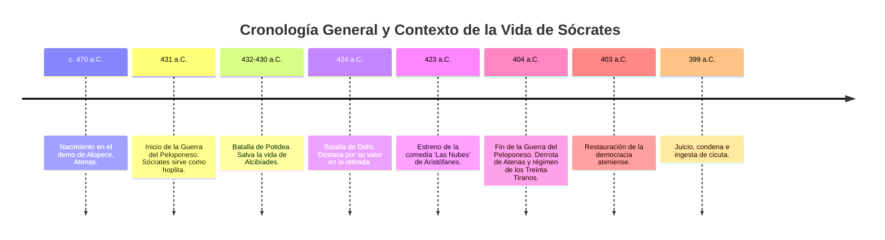
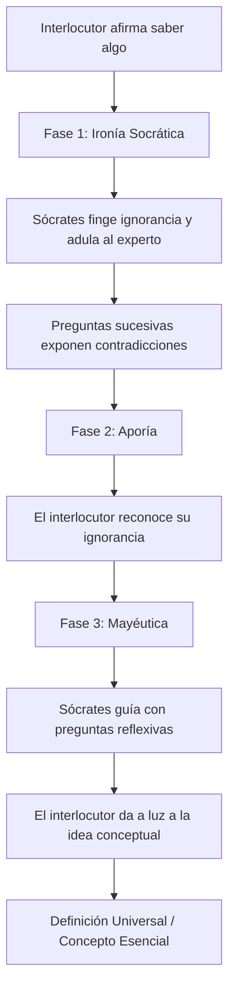
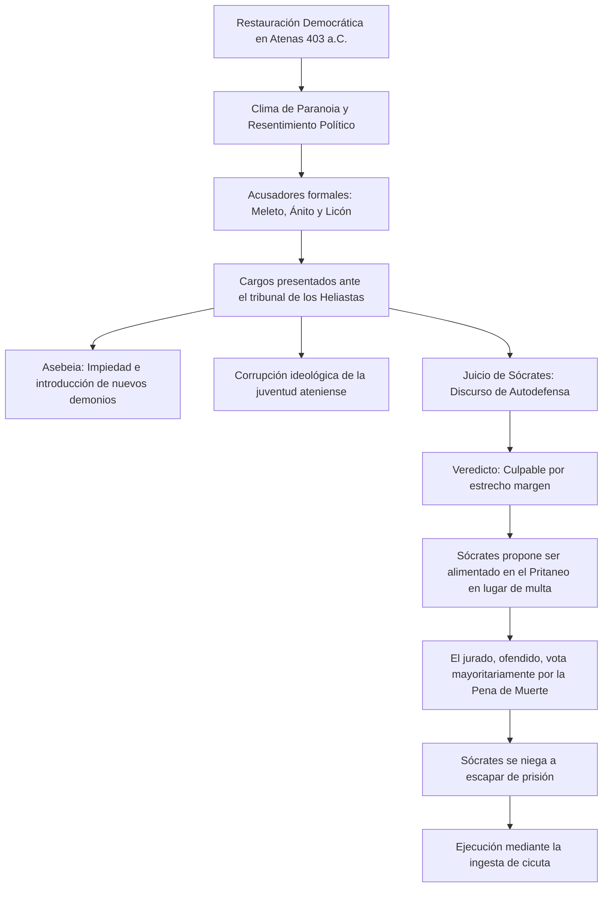
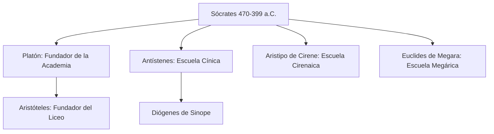

# 🏛️ Biografía Exhaustiva de Sócrates: El Padre de la Filosofía Moral

Sócrates de Atenas (c. 470 a.C. – 399 a.C.) es una de las figuras más enigmáticas, influyentes y fundacionales de la historia del pensamiento occidental. A diferencia de los pensadores que le precedieron, conocidos colectivamente como los presocráticos, Sócrates no orientó su intelecto hacia la explicación del origen del universo físico o la naturaleza material (la *physis*). En su lugar, provocó una revolución intelectual al dirigir la investigación filosófica hacia el ser humano, la ética, la virtud (*areté*), la justicia y el autoconocimiento.

Su trágica muerte por condena del tribunal ateniense lo convirtió en el primer gran mártir del pensamiento libre, y su método de indagación sigue siendo una herramienta pedagógica y filosófica fundamental hoy en día.

---

## 1. Contexto Histórico y Político: La Atenas del Siglo V a.C.

La vida de Sócrates transcurrió casi por completo en Atenas durante una de las épocas más convulsas y brillantes de la historia griega, un periodo marcado por el auge de la democracia, el esplendor cultural del "Siglo de Pericles" y la devastación de la Guerra del Peloponeso.

### 1.1. El Siglo de Pericles
Durante su juventud, Sócrates presenció la reconstrucción de la Acrópolis, la erección del Partenón y el florecimiento de las artes con figuras como los dramaturgos Sófocles y Eurípides, y el escultor Fidias. Atenas se consolidó como la potencia marítima y cultural del Egeo, atrayendo a intelectuales de todo el mundo griego: los sofistas.

### 1.2. La Guerra del Peloponeso (431 – 404 a.C.)
Este enfrentamiento contra Esparta minó la moral, la economía y la estabilidad de la democracia ateniense. Sócrates sirvió con distinción en el ejército de infantería pesada (hoplita). La posterior derrota de Atenas en el 404 a.C. instauró el sangriento régimen oligárquico de los **Treinta Tiranos**, liderado por antiguos alumnos suyos como Cármides y Critias. La rápida caída de la tiranía y la reinstauración de la democracia en el 403 a.C. dejaron una atmósfera social de paranoia, resentimiento y búsqueda de chivos expiatorios para justificar la desgracia de la polis.

---

## 2. Orígenes, Juventud y Vida Militar

### 2.1. Nacimiento y Linaje
Sócrates nació alrededor del año 470 a.C. en el demo (distrito) de Alopece, al sur de Atenas.
*   **Padre:** Sofronisco, un picapedrero o escultor de clase media. De él heredó Sócrates el oficio de tallar piedra durante su juventud.
*   **Madre:** Fainarate, una partera u obstetra (*maia*). La profesión de su madre sirvió de inspiración directa para la concepción de su método filosófico, la mayéutica (el arte de ayudar a dar a luz a las ideas).

### 2.2. Educación e Influencias
Recibió la educación tradicional de un ciudadano ateniense de clase media: literatura clásica (con especial énfasis en Homero), música, gimnasia y geometría elemental. En su juventud, se sintió atraído por las teorías cosmológicas de Anaxágoras y Arquelao, pero pronto las abandonó al considerarlas incapaces de explicar las causas finales y la moral humana.

### 2.3. El Ciudadano-Soldado
A pesar de su reputación como intelectual abstracto, Sócrates poseía una extraordinaria resistencia física. Combatió en tres campañas militares importantes:
1.  **Sitio de Potidea (432–430 a.C.):** Soportó el frío extremo vistiendo ropas ligeras y rescató al joven general Alcibíades cuando este cayó herido, cediéndole la condecoración al valor.
2.  **Batalla de Delio (424 a.C.):** Se destacó por su calma y retirada ordenada en medio de la derrota ateniense frente a los tebanos.
3.  **Batalla de Anfípolis (422 a.C.):** Acción militar en la costa de Tracia.

Su valentía militar y su inquebrantable integridad civil (como cuando se negó a arrestar al demócrata León de Salamina bajo las órdenes de los Treinta Tiranos) demostraron que su filosofía no era un ejercicio meramente verbal, sino una forma de vida comprometida con el deber y la justicia.

---

## 3. El Pensamiento Socrático e Innovación Filosófica

Sócrates marcó un punto de inflexión. Al descentrar a la filosofía del estudio cosmológico y centrarla en la ética práctica y la búsqueda de la verdad conceptual, fundó las bases de la filosofía moral en Occidente.

### 3.1. El Giro Antropológico
Los presocráticos buscaban el *Arjé* (el principio material del universo: agua, fuego, átomos). Sócrates desplazó la pregunta a: **¿Qué es la justicia? ¿Qué es el bien? ¿Cómo debemos vivir para alcanzar la eudaimonía (felicidad/plenitud)?**

### 3.2. La Revelación del Oráculo de Delfos
El punto de partida de la misión pública de Sócrates ocurrió cuando su amigo Querofonte consultó al Oráculo de Delfos preguntando si existía algún hombre más sabio que Sócrates. La pitonisa respondió de forma tajante: *"Nadie es más sabio que Sócrates"*.

Desconcertado, puesto que era consciente de sus propias limitaciones y de su ignorancia, Sócrates decidió interrogar a los atenienses considerados más sabios (políticos, poetas, artesanos) para desmentir al dios del oráculo. Descubrió que todos creían saber mucho sobre temas complejos, pero en realidad poseían opiniones infundadas y contradictorias. Sócrates concluyó que el dios tenía razón:

> *"Solo sé que no sé nada; y al saber que no sé nada, sé algo más que los que creen saberlo todo".*

A partir de ahí, asumió la misión divina de actuar como el **"tábano de Atenas"**, un insecto molesto que aguijonea al perezoso caballo de la democracia para mantenerlo despierto, cuestionando los dogmas aceptados de la sociedad.

### 3.3. El Método Socrático: Dialéctica en Acción
El método dialéctico socrático se compone de tres fases diferenciadas que conducen al interlocutor desde la falsa certeza hasta la aproximación de una verdad universal.

1.  **La Ironía Socrática:** Sócrates entabla conversación alabando los conocimientos del interlocutor sobre un tema determinado (ej. la piedad con Eutifrón, la justicia con Trasímaco). Mediante preguntas incisivas y lógicas, Sócrates va mostrando las inconsistencias internas y las contradicciones de las afirmaciones iniciales de su interlocutor.
2.  **La Aporía:** El estado de confusión intelectual al que llega el interlocutor al darse cuenta de que lo que creía dominar con absoluta seguridad carece de bases lógicas firmes. Es el momento en que se derriba el falso saber.
3.  **La Mayéutica:** Del griego *maieutike* (arte de la partera). Sócrates no enseña ni impone sus propias doctrinas; en su lugar, ayuda al interlocutor a "dar a luz" la verdad que ya yace latente dentro de su propia alma. El conocimiento verdadero proviene del interior a través de la razón propia.

### 3.4. Intelectualismo Moral
Una de las tesis éticas más controvertidas de Sócrates es el intelectualismo moral, que vincula directamente el conocimiento con la virtud:
*   **La virtud es conocimiento:** Solo aquel que conoce lo que es verdaderamente bueno puede actuar de acuerdo al bien.
*   **El mal es ignorancia:** Quien hace el mal no lo hace por maldad intrínseca o debilidad de la voluntad (*acrasia*), sino porque ignora qué es el bien y confunde una apariencia de bien (el placer inmediato, la riqueza) con el verdadero bienestar de su alma.
*   *Consecuencia:* No se debe castigar con venganza, sino educar al criminal, puesto que su crimen es fruto de un error intelectual.

---

## 4. Sócrates frente a los Sofistas

En la Atenas clásica, Sócrates era frecuentemente confundido con los sofistas debido a que ambos pasaban sus días discutiendo en el Ágora y cuestionando las costumbres tradicionales. Sin embargo, su filosofía, intenciones y ética eran diametralmente opuestas.

| Dimensión | Sócrates | Los Sofistas (Protágoras, Gorgias, etc.) |
| :--- | :--- | :--- |
| **Búsqueda Intelectual** | Verdad universal y objetiva (esencias conceptuales). | Relativismo y escepticismo (el ser humano es la medida de todas las cosas). |
| **Fin de la Educación** | El perfeccionamiento del alma y la virtud (*areté*). | Éxito político, influencia social y persuasión en los juicios. |
| **Cobro de Honorarios** | No cobraba. Vivía en la pobreza voluntaria. | Cobraban sumas astronómicas por enseñar retórica. |
| **Método Educativo** | Diálogo crítico y dialéctica cooperativa (mayéutica). | Discursos persuasivos largos (oratoria y erística). |
| **Actitud Filosófica** | "Solo sé que no sé nada" (humildad intelectual). | Pretensión de saberlo todo y enseñar a ganar cualquier debate. |

---

## 5. Relaciones Familiares y Círculo Íntimo

### 5.1. Jantipa y sus Hijos
Aproximadamente a los cincuenta años, Sócrates se casó con **Jantipa**, una mujer considerablemente más joven con la que tuvo tres hijos: Lamprocles, Sofronisco y Menexeno. La tradición histórica describe a Jantipa como una mujer de temperamento indómito y agresivo, a menudo exasperada por el hecho de que su marido no aportara dinero al hogar debido a sus divagaciones filosóficas en el Ágora. Sócrates, sin embargo, toleraba sus explosiones con paciencia estoica, argumentando que si lograba sobrellevar el mal genio de su esposa, podría lidiar fácilmente con cualquier otro carácter humano.

### 5.2. Los Discípulos y el "Círculo Socrático"
Sócrates no fundó una academia formal (eso lo haría su discípulo Platón), pero atrajo a un selecto grupo de jóvenes de la aristocracia ateniense cautivados por su oratoria y su capacidad para ridiculizar a los demagogos influyentes de la ciudad:

*   **Platón:** Quien inmortalizó a su maestro convirtiéndolo en el protagonista indiscutible de casi todos sus diálogos de juventud, madurez y vejez.
*   **Jenofonte:** Historiador y militar. Retrató a un Sócrates mucho más pragmático, moralista y enfocado en el sentido común cotidiano en sus obras *Memorables* y *Simposio*.
*   **Alcibíades:** Político y general carismático, cuya turbulenta vida militar y traición política a Atenas durante la Guerra del Peloponeso dañaron severamente la reputación de su maestro Sócrates a ojos de la opinión pública democrática.
*   **Antístenes:** Fundador de la escuela cínica, impresionado por la extrema sencillez, el desapego material y la autarquía (autosuficiencia) de Sócrates.
*   **Aristipo de Cirene:** Fundador de la escuela cirenaica (hedonismo ético), quien adoptó de Sócrates la búsqueda del dominio de uno mismo frente a los placeres corporales.

---

## 6. El Juicio, Condena y Muerte (399 a.C.)

En el año 399 a.C., Sócrates fue formalmente llevado a juicio en Atenas. El proceso, que culminó en su ejecución, es uno de los episodios más célebres y documentados de la antigüedad clásica.

### 6.1. Las Acusaciones Oficiales
La acusación formal fue redactada por el poeta **Meleto**, con el respaldo político del influyente curtidor y político demócrata **Ánito**, y el orador **Licón**. Los cargos oficiales presentados ante el tribunal de los Heliastas fueron dos:

1.  **Impiedad e Introducción de Nuevas Deidades (*Asebeia*):** Se acusó a Sócrates de no creer en los dioses oficiales de la polis de Atenas y de adorar a una entidad mística extraña: su *daimonion* (una especie de voz o conciencia interior que, según él, le advertía lo que no debía hacer).
2.  **Corrupción de la Juventud:** Se le culpaba de infundir ideas rebeldes y escépticas en los jóvenes de la aristocracia, incitándolos a desobedecer a sus padres y a cuestionar la legitimidad de las instituciones democráticas tradicionales.

### 6.2. El Desarrollo del Juicio
El tribunal estaba compuesto por un jurado popular de unos 501 ciudadanos atenienses. La defensa de Sócrates, recreada en la *Apología de Sócrates* de Platón y Jenofonte, no buscó la compasión del jurado ni empleó los trucos retóricos sofistas habituales de la época (como llevar a su esposa y a sus hijos al tribunal para llorar ante los jueces).

Sócrates defendió su labor como un mandato divino ineludible y se negó a disculparse o comprometer sus principios.
*   **Veredicto de Culpabilidad:** Fue declarado culpable por un margen estrecho de votos (aproximadamente 280 contra 221).
*   **La Pena:** De acuerdo a las leyes atenienses, el acusador proponía una pena (Meleto propuso la muerte) y el acusado debía proponer una alternativa razonable. En lugar de sugerir el exilio o una fuerte multa monetaria, Sócrates declaró con ironía que, debido al servicio que le había prestado a Atenas al despertarla de su letargo intelectual, merecía ser alimentado de por vida gratis en el **Pritaneo** (el edificio público donde se agasajaba a los héroes olímpicos y benefactores de la ciudad).
*   **Condena a Muerte:** El jurado, sintiéndose insultado y desafiado por su arrogancia filosófica, votó nuevamente. Esta vez, una mayoría abrumadora votó a favor de la pena de muerte.

### 6.3. Los Últimos Días y la Cicuta
Sócrates pasó unos treinta días en prisión esperando su ejecución, postergada por una festividad religiosa ateniense en honor a Apolo. Durante este periodo, sus amigos ricos, liderados por Critón, sobornaron a los guardias de la cárcel y prepararon un plan detallado de escape para llevarlo a salvo al exilio en la vecina ciudad de Tebas o Megara.

Sócrates rechazó tajantemente la propuesta de huir (como se narra en el diálogo platónico *Critón*). Argumentó que violar las leyes de la ciudad para salvar su propia vida equivalía a destruir la polis y cometer una injusticia mayor. El filósofo debía someterse a las sentencias de los tribunales legítimos, incluso si eran injustas.

El último día de Sócrates está inmortalizado en el diálogo *Fedón*. Rodeado de sus discípulos más cercanos, discutió sobre la inmortalidad del alma y la naturaleza del más allá. Cuando llegó el verdugo, Sócrates bebió con serenidad el veneno preparado de la **cicuta** (*Conium maculatum*). Sus últimas palabras, dirigidas a su amigo Critón, fueron:

> *"Critón, le debemos un gallo a Asclepio; págaselo, no te descuides".*

*Nota: Asclepio era el dios griego de la medicina. Sacrificarle un gallo era una muestra de gratitud por haber sanado de una enfermedad. Al pronunciar estas palabras, Sócrates sugería que la vida terrenal era una dolencia de la cual la muerte finalmente lo curaba y liberaba a su alma.*

---

## 7. El Legado de Sócrates y su Recepción Histórica

Sócrates no dejó ningún escrito original. Creía que la palabra escrita endurecía el pensamiento libre e impedía el diálogo dinámico entre las mentes vivas. Su legado se transmitió a través de sus discípulos y dio origen a múltiples corrientes de pensamiento divergentes:

### 7.1. Las Escuelas Socráticas
Tras su muerte, el pensamiento socrático se ramificó de formas sorprendentes:
*   **Platonismo:** Platón refinó las ideas éticas y el método dialéctico de su maestro, proyectándolos hacia su teoría metafísica de las Ideas o Formas.
*   **Cinismo:** Antístenes y Diógenes de Sinope radicalizaron el ejemplo de Sócrates de pobreza voluntaria y desprecio por las convenciones sociales, abogando por una vida natural y autosuficiente.
*   **Cirenaicos:** Aristipo argumentó que el fin de la conducta moral es el placer físico y mental regulado por la razón práctica.

---

## 8. El Problema Socrático (Las Fuentes de Información)

Dado que Sócrates no escribió nada, los historiadores de la filosofía se enfrentan a lo que se conoce como el **"Problema Socrático"**: discernir el pensamiento histórico real de Sócrates a través de los testimonios de los autores contemporáneos, que a menudo son contradictorios entre sí.

| Fuente Histórica | Perspectiva o Retrato de Sócrates | Obras Principales | Ventajas y Limitaciones |
| :--- | :--- | :--- | :--- |
| **Platón** | Sócrates como el filósofo ideal, portador de una profunda teoría metafísica y epistemológica. | *Apología*, *Gorgias*, *Fedón*, *La República*. | **Ventajas:** Detalle filosófico extraordinario y profundidad.  **Limitaciones:** En los diálogos de madurez, Platón usó a Sócrates como un portavoz de sus propias teorías (como la Teoría de las Ideas). |
| **Jenofonte** | Un ciudadano sabio, piadoso, práctico, centrado en dar buenos consejos cotidianos y gobernar el hogar. | *Recuerdos de Sócrates*, *Apología*, *Económico*. | **Ventajas:** Retrato realista de su vida social ordinaria.  **Limitaciones:** Menos profundidad filosófica; no explica por qué la filosofía de Sócrates irritaba tanto a Atenas como para condenarlo a muerte. |
| **Aristófanes** | Un sofista excéntrico, cobrador de dinero, que estudia fenómenos naturales disparatados en "Las Nubes". | Comedia *Las Nubes* (423 a.C.). | **Ventajas:** Única fuente contemporánea escrita en vida de Sócrates.  **Limitaciones:** Es una sátira cómica caricaturizada para hacer reír a los ciudadanos y desprestigiarlo políticamente. |
| **Aristóteles** | Un pensador racional enfocado en el método deductivo-inductivo y la búsqueda de definiciones universales en el campo de la ética. | *Metafísica*, *Ética a Nicómaco*. | **Ventajas:** Perspectiva objetiva y sistemática (no conoció personalmente a Sócrates).  **Limitaciones:** Fuentes indirectas; trata a Sócrates solo como un peldaño evolutivo hacia su propio sistema. |

---

## 9. Glosario de Conceptos Socráticos

*   **Aporía:** Estado de incertidumbre e impotencia intelectual al que se llega tras el cuestionamiento socrático, reconociendo la falta de fundamentos para una idea preconcebida.
*   **Areté:** Concepto griego de excelencia o virtud, que para Sócrates equivalía al correcto funcionamiento del alma humana a través de la razón.
*   **Daimonion:** Voz espiritual interna que Sócrates decía escuchar y que lo prevenía de cometer malas acciones o tomar malas decisiones prácticas.
*   **Dialéctica:** Método de razonamiento a través de la confrontación dialogada de opiniones, guiado por la lógica para descubrir definiciones universales.
*   **Eudaimonía:** Bienestar moral y florecimiento humano, comúnmente traducido como felicidad, que se alcanza únicamente viviendo virtuosamente.
*   **Intelectualismo Moral:** Teoría ética socrática que sostiene que el comportamiento virtuoso está determinado por el conocimiento de lo que es bueno, y que el vicio moral es siempre consecuencia de la ignorancia.
*   **Mayéutica:** Parte constructiva del método socrático en la que el filósofo, a través de preguntas reflexivas, guía al interlocutor para que engendre la verdad de su propia mente.

## 🔗 Suggested Connections
- [[🏛️ The Roman Empire: An Exhaustive Historical and Structural Analysis]] — High semantic similarity.
- [[🤖 The Evolution of Artificial Intelligence: From Symbolic Logic to Generative Foundations]] — High semantic similarity.
- [[gothic_architecture]] — High semantic similarity.
