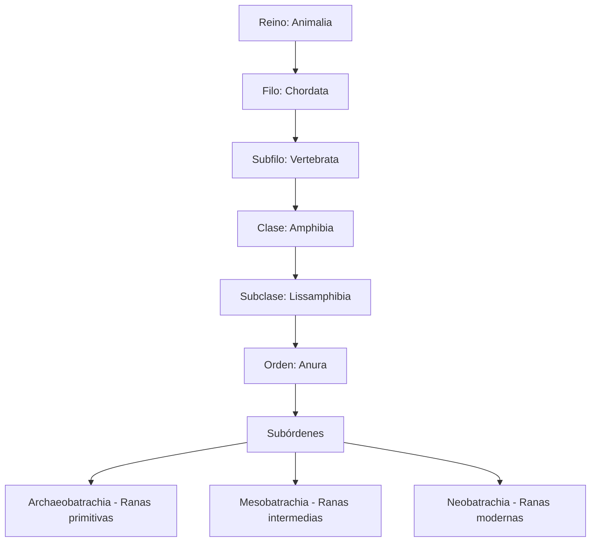
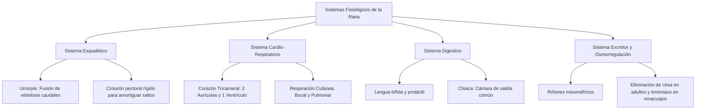
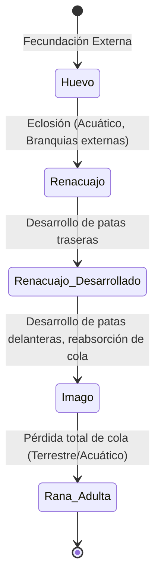
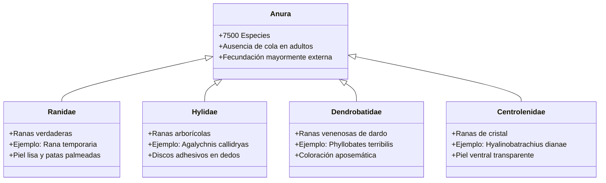

# 🐸 Biología de las Ranas: Un Análisis Exhaustivo de los Anuros

Las ranas son uno de los grupos de vertebrados más fascinantes, diversos y adaptables del planeta. Pertenecientes al orden **Anura** (del griego *an-*, sin, y *oura*, cola), estos anfíbios representan un eslabón evolutivo crucial entre la vida acuática y la terrestre. Con más de 7,500 especies descritas, muestran una increíble variedad de adaptaciones anatómicas, fisiológicas, reproductivas y ecológicas.

Este documento ofrece un estudio profundo y detallado de su biología, diseñado para estudiantes, naturalistas y entusiastas de la herpetología.

---

## 1. Clasificación Taxonómica y Diversidad

El orden Anura es el más grande dentro de la clase Amphibia, abarcando aproximadamente el 88% de todas las especies de anfíbios vivos.

### 1.1. Posición Taxonómica
El siguiente esquema ilustra la jerarquía taxonómica de las ranas:

### 1.2. Ranas vs. Sapos: Diferencias Biológicas
Aunque popularmente se distingue entre "rana" y "sapo", esta distinción carece de un valor taxonómico estricto. "Sapo" suele referirse a especies de la familia Bufonidae o a anuros con piel rugosa y hábitos terrestres, mientras que "rana" describe a especies con piel lisa y hábitos más acuáticos o arborícolas.

| Característica | Ranas (Generalmente) | Sapos (Generalmente) |
| :--- | :--- | :--- |
| **Piel** | Lisa, húmeda, resbaladiza y delgada. | Rugosa, seca, glandular y verrugosa. |
| **Locomoción** | Extremidades traseras largas adaptadas para saltar. | Extremidades cortas adaptadas para caminar o dar saltos cortos. |
| **Hábitat** | Mayormente acuático, semiacuático o arborícola. | Terrestre, prefieren ambientes húmedos pero no necesariamente acuáticos (fuera de la época de cría). |
| **Dentición** | Dientes maxilares y vomerianos presentes en la mayoría. | Ausencia total de dientes. |
| **Glándulas Parotoides** | Ausentes o poco desarrolladas. | Grandes glándulas detrás de los ojos que segregan toxinas (bufotoxinas). |
| **Puesta de huevos** | En masas globulares o racimos flotantes. | En largas cadenas o cordones gelatinosos. |

---

## 2. Anatomía Externa y Morfología

La morfología externa de una rana está sumamente especializada para su estilo de vida anfibio y su modo de locomoción saltatorio.

### 2.1. La Piel (Tegumento)
La piel de los anuros es un órgano multifuncional de vital importancia. A diferencia de los reptiles u otros vertebrados terrestres, carece de escamas, plumas o pelo.

*   **Epidermis y Dermis:** La epidermis es delgada y se descama periódicamente (muda). La dermis es rica en vasos sanguíneos y glándulas.
*   **Glándulas Mucosas:** Secretan un moco acuoso que mantiene la piel húmeda, facilitando la respiración cutánea y previniendo la desecación en ambientes terrestres.
*   **Glándulas Granulares (Venenosas):** Producen toxinas de diversa índole (alcaloides, péptidos, aminas biogénicas) que actúan como defensa contra depredadores y patógenos. Su concentración es máxima en familias como *Dendrobatidae*.
*   **Cromatóforos:** Células pigmentarias responsables de la coloración y los patrones. Se dividen en tres capas superpuestas:
    1.  *Melanóforos:* Capa más profunda, contienen melanina (tonos oscuros, marrones y negros).
    2.  *Iridóforos:* Capa intermedia, contienen cristales de purina que reflejan y refractan la luz (producen tonos azules y metálicos).
    3.  *Xantóforos:* Capa superior, contienen carotenoides y pteridinas (tonos amarillos, naranjas y rojos).
    *Nota: La combinación de la luz reflejada azul de los iridóforos con los pigmentos amarillos de los xantóforos da como resultado el color verde típico de muchas ranas.*

### 2.2. Extremidades y Adaptaciones Locomotoras
La estructura esquelética y muscular de las patas traseras está modificada para el salto y la natación:

*   **Fémur, Tibiofibula y Astrágalo-Calcáneo:** Los huesos de las extremidades posteriores están fusionados (la tibia y el peroné forman la tibiofibula) y los huesos del tobillo (astrágalo y calcáneo) están sumamente alargados, actuando como una palanca adicional que maximiza la potencia del salto.
*   **Membranas Interdigitales:** Presentes en especies acuáticas para facilitar la propulsión en el agua.
*   **Discos Adhesivos:** Ranas arborícolas (familia *Hylidae*, *Centrolenidae*) poseen almohadillas en las puntas de los dedos con canales microscópicos llenos de moco que generan fuerzas de adhesión capilar y fricción, permitiéndoles escalar superficies verticales lisas.

### 2.3. Órganos de los Sentidos
*   **Ojos:** Grandes y protuberantes, proporcionan un campo de visión casi de 360 grados. Poseen una **membrana nictitante** (un tercer párpado transparente) que protege el ojo bajo el agua y lo mantiene húmedo en tierra.
*   **Oído:** Carecen de oído externo. El **tímpano** es una membrana circular visible en los costados de la cabeza que transmite las vibraciones del aire a la columela (oído medio) y de ahí al oído interno. En los machos de muchas especies, el tímpano es más grande que el ojo.
*   **Órgano de Jacobson (Vomeronasal):** Utilizado para detectar señales químicas no volátiles del aire o del agua, situado en la cavidad nasal.

---

## 3. Anatomía Interna y Fisiología

A nivel interno, las ranas exhiben una organización estructural de transición entre los peces (totalmente acuáticos) y los amniotas (totalmente terrestres).

### 3.1. Sistema Esquelético
El esqueleto de los anuros está altamente modificado y simplificado para soportar el impacto del salto:

*   **Reducción Ósea:** Tienen menos vértebras que otros vertebrados (usualmente entre 8 y 9 vértebras presacras). Carecen de costillas verdaderas.
*   **Urostyle (Urostilo):** Hueso largo y variforme situado en la parte posterior de la columna vertebral, formado por la fusión de las vértebras caudales embrionarias. Proporciona rigidez al tronco durante el salto.
*   **Cinturón Pectoral:** Actúa como un amortiguador que absorbe el impacto de la caída al aterrizar con las patas delanteras. Puede ser de tipo *arcífero* (las mitades se superponen) o *firmisterno* (las mitades están fusionadas en la línea media).

### 3.2. Sistema Respiratorio
Las ranas adultas emplean tres mecanismos complementarios para el intercambio gaseoso:

1.  **Respiración Cutánea (Piel):** Ocurre tanto en el agua como en el aire. La piel húmeda y altamente vascularizada permite la difusión pasiva de oxígeno y dióxido de carbono. En algunas especies (ej. la rana del lago Titicaca, *Telmatobius culeus*), los pulmones están atrofiados y la respiración es casi exclusivamente cutánea.
2.  **Respiración Bucofaríngea:** El aire entra a la cavidad bucal a través de las narinas mediante el movimiento del piso de la boca. El intercambio gaseoso ocurre directamente a través de la mucosa bucal altamente vascularizada.
3.  **Respiración Pulmonar:** Los pulmones son sacos elásticos de paredes delgadas y pocos alvéolos, lo que limita su eficiencia. Al carecer de diafragma y costillas, las ranas respiran mediante **bombeo de presión positiva**:
    *   *Fase 1:* El piso de la boca desciende con las narinas abiertas, llenando la cavidad bucal de aire fresco.
    *   *Fase 2:* Las narinas se cierran, la glotis se abre y el aire usado de los pulmones pasa por la boca y sale por las narinas (o se mezcla ligeramente).
    *   *Fase 3:* El piso de la boca se eleva con las narinas cerradas, forzando el aire fresco a entrar a los pulmones.

### 3.3. Sistema Circulatorio
El sistema circulatorio es cerrado y doble (circuito pulmonar y circuito sistémico), impulsado por un **corazón de tres cámaras**:

*   **Aurícula Derecha:** Recibe sangre desoxigenada (venosa) del cuerpo a través del seno venoso.
*   **Aurícula Izquierda:** Recibe sangre oxigenada de los pulmones y de la piel.
*   **Ventrículo Único:** A pesar de no tener tabique interno divisorio, la mezcla de sangre se reduce al mínimo gracias a la presencia de crestas musculares espirales en el ventrículo y el cono arterioso, que dirigen la sangre desoxigenada preferentemente hacia las arterias pulmocutáneas y la sangre oxigenada hacia el arco sistémico y las carótidas.

### 3.4. Sistema Digestivo
Las ranas adultas son estrictamente carnívoras y depredadoras activas.

*   **Captura de Presas:** La mayoría posee una lengua musculosa, bífida y glandular en su extremo posterior, anclada en la parte frontal de la mandíbula inferior. Al proyectarse rápidamente hacia afuera, la lengua secreta un moco altamente viscoso y adhesivo que atrapa a la presa.
*   **Mecánica de Deglución:** Carecen de dientes adaptados para masticar (tienen pequeños dientes maxilares y vomerianos para retener la presa). Durante la deglución, los ojos se hunden hacia adentro de la cavidad bucal a través de aberturas en el cráneo para empujar mecánicamente el bolo alimenticio hacia el esófago.
*   **Tracto Digestivo:** Es corto en los adultos (típico de carnívoros) y consta de esófago, estómago, intestino delgado, intestino grueso y desemboca en la **cloaca**, una cámara común donde también confluyen los sistemas excretor y reproductor.

### 3.5. Excreción y Osmorregulación
*   **Riñones:** Poseen un par de riñones mesonéfricos alargados situados dorsalmente.
*   **Desechos Nitrogenados:** Los renacuajos (acuáticos) excretan **amoniaco** (amonotélicos), que es altamente tóxico pero requiere poca energía para producirse y se diluye fácilmente en el agua. Las ranas adultas (más terrestres) convierten el amoniaco en **urea** (ureotélicos), que es menos tóxica y requiere menos agua para su almacenamiento y excreción.
*   **Equilibrio Hídrico:** Las ranas no beben agua por la boca. La absorben directamente a través de una zona altamente permeable de la piel en la región pélvica e inguinal, conocida como el **parche pélvico** o "parche de bebida".

---

## 4. Reproducción y Ciclo de Vida

La reproducción de las ranas está íntimamente ligada al agua y exhibe una enorme variedad de estrategias adaptativas.

### 4.1. Cortejo y Amplexo
Durante la temporada de reproducción, los machos migran a los cuerpos de agua y emiten cantos para atraer a las hembras y delimitar territorios. Cuando una hembra receptiva se acerca, el macho la sujeta firmemente en un abrazo reproductivo denominado **amplexo**.

Existen dos tipos principales de amplexo en anuros:
*   **Amplexo Axilar:** El macho sujeta a la hembra por debajo de las axilas (común en ranas modernas o Neobatrachia).
*   **Amplexo Inguinal:** El macho sujeta a la hembra por la región de la pelvis/ingle (característico de familias más primitivas).

La fecundación es predominantemente **externa**. La hembra deposita los huevos en el agua mientras el macho descarga el esperma directamente sobre ellos.

### 4.2. El Proceso de Metamorfosis
El ciclo de vida de los anuros involucra una transformación morfológica y fisiológica drástica denominada metamorfosis, regulada por las hormonas tiroideas (tiroxina y triyodotironina).

A continuación se detallan las fases de transición y los cambios que experimenta el organismo:

| Fase de Desarrollo | Características Morfológicas | Fisiología Respiratoria | Tipo de Alimentación | Hábitat |
| :--- | :--- | :--- | :--- | :--- |
| **Huevo** | Esfera rodeada por múltiples capas de gelatina protectora. | Difusión pasiva a través del gel. | Nutrición a partir del vitelo. | Acuático / Húmedo |
| **Renacuajo Inicial** | Cuerpo pisciforme, presencia de cola larga, branquias externas rudimentarias. | Branquias externas, luego internas. | Detritívoro, raspador de algas (microfagia). | Estrictamente acuático |
| **Renacuajo con Patas** | Aparición de extremidades traseras. La cola sigue siendo el órgano locomotor principal. | Branquias internas e inicio de desarrollo pulmonar. | Herbívoro / Detritívoro. | Acuático |
| **Imago (Metamórfico)** | Emergencia de extremidades delanteras. Reabsorción de la cola por apoptosis. Boca ensanchada. | Pulmonar y cutánea (las branquias desaparecen). | Ayuno (reabsorción de la cola provee energía). | Transición acuático-terrestre |
| **Adulto** | Ausencia total de cola. Extremidades adaptadas para salto. Boca ancha con lengua extensible. | Pulmonar, cutánea y bucofaríngea. | Carnívoro / Insectívoro estricto. | Acuático, terrestre o arborícola |

### 4.3. Cuidado Parental Excepcional
Aunque muchas especies abandonan sus huevos, otras muestran comportamientos de cuidado parental complejos:
*   *Dendrobates:* Transportan a los renacuajos recién nacidos en sus espaldas hacia pequeñas reservas de agua en bromelias (fitotelmata). Las madres regresan periódicamente a depositar huevos no fecundados para alimentar a los renacuajos (oofagia).
*   *Rhinoderma darwinii (Rana de Darwin):* Los machos tragan los huevos en desarrollo y los incuban dentro de su saco vocal hasta que emergen como ranitas completamente formadas (neomelia).
*   *Rheobatrachus (Ranas de incubación gástrica - Extintas):* La hembra tragaba los huevos fecundados y suspendía la producción de jugos gástricos en su estómago, incubando allí a las crías.

---

## 5. Ecología y Comportamiento

Las ranas desempeñan un papel fundamental en las redes tróficas y el flujo de energía en los ecosistemas de todo el mundo.

### 5.1. Ectotermia y Adaptaciones Térmicas
Al ser animales ectotermos, su temperatura corporal depende de las fuentes de calor externas.
*   **Termorregulación Conductual:** Se asolean para elevar su temperatura o buscan sombra y agua para enfriarse.
*   **Hibernación:** Especies de climas templados se entierran en el lodo del fondo de estanques o bajo tierra para pasar el invierno en un estado de metabolismo extremadamente reducido. Algunas ranas (como la rana de la madera, *Lithobates sylvaticus*) pueden sobrevivir al congelamiento parcial de sus fluidos corporales gracias a la acumulación de glucosa e urea en sus tejidos, que actúan como crioprotectores.
*   **Estivación:** En zonas áridas, las ranas se entierran durante la estación seca dentro de capullos hechos de su propia piel mudada para conservar la humedad.

### 5.2. Mecanismos de Defensa
*   **Cripticismo (Mimetismo):** Muchas ranas tienen coloraciones verdes, marrones o grises que les permiten pasar completamente desapercibidas ante los ojos de los depredadores en el follaje o el suelo del bosque.
*   **Aposematismo:** Coloraciones de advertencia extremadamente llamativas (rojos, azules, amarillos vibrantes) que señalan a los depredadores la presencia de potentes toxinas cutáneas. Es el caso de las ranas venenosas de dardo de la familia Dendrobatidae.
*   **Mimetismo Batesiano:** Especies no venenosas que imitan los patrones de coloración de las venenosas para ahuyentar a sus depredadores.

---

## 6. Principales Familias y Ejemplos de Especies

El orden Anura presenta una gran variedad de familias adaptadas a nichos específicos.

A continuación se detallan las características principales de las familias más representativas del orden Anura:

### 6.1. Familias Destacadas y sus Características

#### Familia **Ranidae** (Ranas verdaderas)
*   **Distribución:** Cosmopolita (excepto en la Antártida y áreas extremadamente áridas).
*   **Hábitat:** Principalmente dulceacuícolas (lagos, estanques, ríos lentos).
*   **Características:** Patas traseras largas y musculosas, membranas interdigitales muy desarrolladas, piel lisa.
*   **Especie representativa:** *Lithobates catesbeianus* (Rana toro).

#### Familia **Hylidae** (Ranas arborícolas comunes)
*   **Distribución:** América, Eurasia, Australia.
*   **Hábitat:** Bosques, selvas tropicales, vegetación ribereña.
*   **Características:** Discos adhesivos en las puntas de los dedos, ojos orientados lateralmente, complexión grácil y ligera.
*   **Especie de ejemplo:** *Agalychnis callidryas* (Rana arborícola de ojos rojos).

#### Familia **Dendrobatidae** (Ranas venenosas de dardo)
*   **Distribución:** Neotrópico (América Central y del Sur).
*   **Hábitat:** Suelo de bosques lluviosos tropicales.
*   **Características:** Coloración aposemática brillante. Producen toxinas alcaloides (obtenidas de su dieta de hormigas y ácaros). Cuidado parental complejo.
*   **Especie de ejemplo:** *Phyllobates terribilis* (Rana dardo dorada - el vertebrado más tóxico del planeta).

#### Familia **Centrolenidae** (Ranas de cristal)
*   **Distribución:** Selvas montanas de América Central y del Sur.
*   **Hábitat:** Arbustos y árboles a orillas de arroyos torrentosos.
*   **Características:** La piel de su abdomen es translúcida, lo que permite observar sus órganos internos (corazón, hígado, intestinos y huesos) desde el exterior.
*   **Especie de ejemplo:** *Espadarana prosoblepon* (Rana de cristal esmeralda).

#### Familia **Pipidae** (Ranas acuáticas sin lengua)
*   **Distribución:** América del Sur y África subsahariana.
*   **Hábitat:** Cuerpos de agua permanentes.
*   **Características:** Totalmente acuáticas, carecen de lengua (utilizan sus manos para meter la comida en la boca), cuerpos aplanados dorsoventralmente y ojos pequeños orientados hacia arriba.
*   **Especie de ejemplo:** *Xenopus laevis* (Rana de garras africana - ampliamente utilizada como organismo modelo en laboratorios de desarrollo embriológico).

---

## 7. Importancia Ecológica y Conservación

Las ranas son consideradas "centinelas ecológicos" o excelentes **bioindicadores** de la salud ambiental debido a dos factores principales: su piel altamente permeable y su ciclo de vida bifásico (acuático y terrestre). Cualquier alteración por contaminación química en el agua, radiación UV o cambio de temperatura en la tierra las afecta de manera directa e inmediata.

### 7.1. Principales Amenazas Globales
*   **Pérdida de Hábitat:** La deforestación, la desecación de humedales y la fragmentación de ecosistemas forestales reducen drásticamente sus poblaciones.
*   **Quitridiomicosis:** Enfermedad infecciosa provocada por el hongo quítrido *Batrachochytrium dendrobatidis* (Bd). El hongo ataca la queratina de la piel de las ranas, interfiriendo con su capacidad para respirar e intercambiar agua y electrolitos, lo que les causa un paro cardíaco. Esta pandemia ha sido responsable del declive y la extinción de cientos de especies de anuros a nivel mundial.
*   **Contaminación Química:** Los pesticidas, herbicidas (como la atrazina, que causa disrupción endocrina y feminización en los machos) y los fertilizantes agrícolas contaminan sus cuerpos de agua.
*   **Cambio Climático:** La alteración de los regímenes de lluvia y el aumento de las temperaturas secan los hábitats de reproducción y alteran sus patrones estacionales de cría.
*   **Especies Introducidas:** La introducción de especies exóticas invasoras (como la trucha en lagunas altoandinas o la misma rana toro fuera de su rango nativo) desplaza y depreda a las especies autóctonas.

La conservación de este orden de anfibios es fundamental no solo para preservar la biodiversidad mundial, sino también para mantener el control biológico de plagas de insectos y asegurar la estabilidad de los ecosistemas donde habitan.

---

## 8. Glosario Científico de Herpetología

Para una mejor comprensión de los términos técnicos utilizados en este documento:

*   **Amplexo:** Abrazo nupcial mediante el cual el macho de los anfibios anuros fecunda los huevos de la hembra a medida que esta los expulsa.
*   **Anuro:** Grupo de anfibios caracterizados por la ausencia de cola en estado adulto, cuerpo corto y patas traseras muy desarrolladas para el salto.
*   **Aposematismo:** Fenómeno por el cual ciertos organismos vivos presentan rasgos llamativos a la vista (colores brillantes) para advertir a sus depredadores de su toxicidad o mal sabor.
*   **Cromatóforo:** Célula con pigmentos en su interior que refleja la luz y es la responsable de la coloración de la piel.
*   **Ectotermia:** Propiedad de ciertos animales cuya temperatura corporal varía con la del medio ambiente debido a que carecen de mecanismos fisiológicos internos reguladores.
*   **Glandula Parotoide:** Glándula salival modificada de gran tamaño situada detrás de los ojos en sapos, capaz de segregar bufotoxinas de defensa.
*   **Imago:** Última etapa del desarrollo de un animal que sufre metamorfosis, correspondiente al estado adulto o subadulto recién transformado.
*   **Membrana Nictitante:** Tercer párpado transparente o translúcido presente en algunos animales que puede dibujarse a través del ojo para protegerlo y humedecerlo sin perder visibilidad.
*   **Metamorfosis:** Proceso biológico por el cual un animal se desarrolla desde su nacimiento hasta la madurez mediante grandes cambios estructurales y fisiológicos.
*   **Tímpano:** Estructura auditiva externa en las ranas que capta las ondas sonoras aéreas y las transmite al oído medio e interno.
*   **Urostyle:** Hueso resultante de la fusión de las vértebras posteriores del coxis, típico de los anfibios anuros, especializado en dar soporte durante el salto.
*   **Vomeriano (Dientes):** Pequeñas estructuras dentadas situadas en el hueso vómer, en el techo de la boca de algunos anfibios, que sirven para sujetar a las presas vivas.

## 🔗 Suggested Connections
- [[🌌 Astronomía General: Del Sistema Solar a la Cosmología Física]] — High semantic similarity.
- [[🏛️ The Roman Empire: An Exhaustive Historical and Structural Analysis]] — High semantic similarity.
- [[🍎 The Chemical Biology and Molecular Composition of Apples (*Malus domestica*)]] — High semantic similarity.
