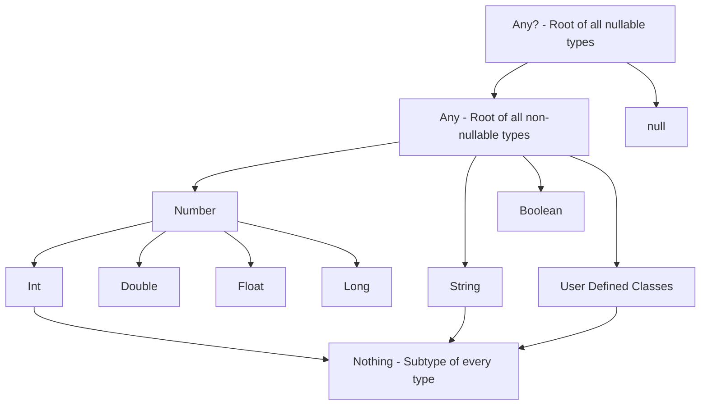
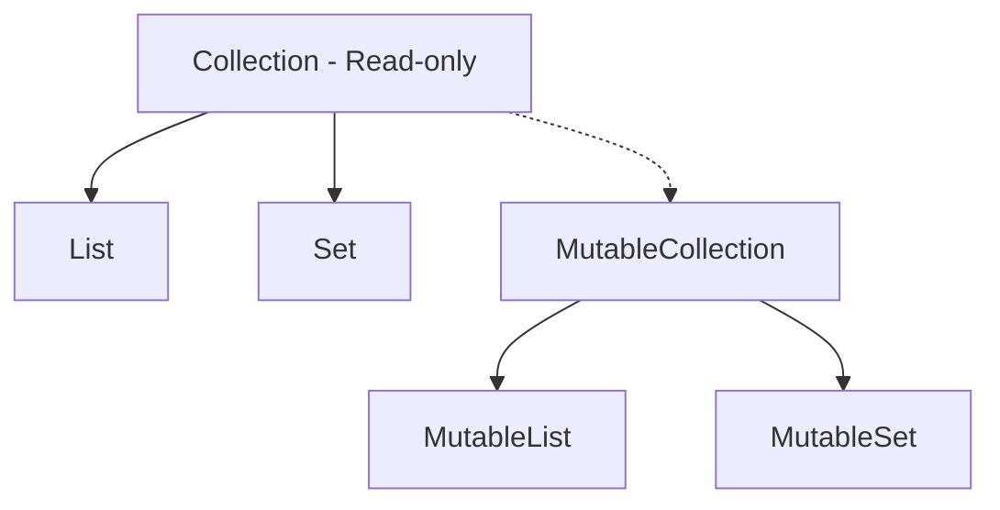

# ☕ Kotlin Fundamentals: A Comprehensive Reference Guide

Kotlin is a modern, cross-platform, statically typed programming language designed by JetBrains. Primarily targeting the Java Virtual Machine (JVM), Kotlin is also compiled to JavaScript (Kotlin/JS) and native machine code (Kotlin/Native), making it the official language for Android development and a powerful option for multiplatform systems (Kotlin Multiplatform - KMP).

This guide provides an in-depth breakdown of Kotlin's core syntax, null-safety guarantees, object-oriented features, functional paradigms, and concurrency models.

---

## 1. Core Philosophy and Type Hierarchy

Kotlin was designed with four key pillars in mind:
1.  **Conciseness:** Reduces boilerplate code (e.g., getters, setters, and builders).
2.  **Safety:** Focuses on eliminating common programming errors, most notably `NullPointerException` (NPE).
3.  **Interoperability:** Seamlessly calls Java code from Kotlin and vice versa.
4.  **Tool-Friendliness:** Developed by an IDE company, ensuring first-class tool support.

### 1.1. Kotlin Type Hierarchy
Unlike Java, Kotlin does not have primitive types at the language level; every type is an object. The type system has a unified hierarchy with a single root:



*   **`Any`:** The supertype of all non-nullable classes (equivalent to `java.lang.Object` on the JVM).
*   **`Unit`:** Equivalent to `void` in Java, but represents a real singleton object. It is returned by functions that do not return a meaningful value.
*   **`Nothing`:** A special type that represents "a value that never exists." It is used to denote functions that never return (e.g., throwing an exception or running an infinite loop).

---

## 2. Basic Syntax and Variables

### 2.1. Mutability: `val` vs `var`
Kotlin enforces immutability as a best practice by providing two keywords for variable declaration:

*   **`val` (Value):** Defines a read-only variable. Once initialized, its reference cannot be reassigned (equivalent to `final` in Java).
*   **`var` (Variable):** Defines a mutable variable whose value can be changed at runtime.

```kotlin
val pi = 3.14159 // Type inferred as Double; read-only
// pi = 3.14    // Compile-time error!

var score = 100 // Type inferred as Int; mutable
score = 150     // Allowed
```

### 2.2. Type Inference and Raw Strings
Kotlin has powerful type inference, meaning you do not have to explicitly declare types unless you want to or in public API designs:

```kotlin
val message: String = "Hello, Kotlin!" // Explicit
val count = 42                         // Inferred as Int

// String Templates
val user = "Alice"
val greeting = "Hello, $user! Your name has ${user.length} characters."

// Raw Strings (Multiline)
val sqlQuery = """
    SELECT id, name, email 
    FROM users 
    WHERE active = true 
    ORDER BY name ASC;
""".trimIndent()
```

---

## 3. Control Flow Expressions

In Kotlin, many control flow constructs are **expressions**, meaning they return a value. This reduces the need for temporary mutable state.

### 3.1. `if` as an Expression
Since `if` returns a value, Kotlin does not need a ternary operator (`condition ? trueVal : falseVal`).

```kotlin
val number = 10
val description = if (number % 2 == 0) {
    "Even"
} else {
    "Odd"
}
```

### 3.2. The `when` Expression
`when` replaces the traditional `switch` statement found in C-style languages. It is safer, more expressive, and forces exhaustiveness when used with sealed classes or enums.

```kotlin
val x = 5
val outcome = when (x) {
    1 -> "One"
    2, 3 -> "Two or Three"
    in 4..10 -> "Between 4 and 10 (inclusive)"
    is Int -> "It is an Integer, but out of range"
    else -> "Unknown value"
}
```

### 3.3. Loops and Ranges
Kotlin provides convenient syntax for iterating over ranges and collections:

```kotlin
// Closed range: 1, 2, 3, 4, 5
for (i in 1..5) print(i)

// Half-open range: 1, 2, 3, 4
for (i in 1 until 5) print(i)

// Stepping and reverse
for (i in 10 downTo 1 step 2) {
    println(i) // 10, 8, 6, 4, 2
}

// Iterating over a list
val items = listOf("A", "B", "C")
for ((index, element) in items.withIndex()) {
    println("Item at $index is $element")
}
```

---

## 4. Null Safety: Eliminating the Billion-Dollar Mistake

Kotlin’s type system distinguishes between references that can hold `null` and those that cannot.

```kotlin
var nonNullableName: String = "Kotlin"
// nonNullableName = null // Compile-time error!

var nullableName: String? = "Kotlin"
nullableName = null // Allowed
```

### 4.1. Null-Safety Operators

| Operator | Name | Syntax | Description |
| :--- | :--- | :--- | :--- |
| **`?.`** | Safe Call Operator | `str?.length` | Returns the length if `str` is not null, otherwise returns `null` safely without throwing an exception. |
| **`?:`** | Elvis Operator | `str?.length ?: 0` | Provides a fallback value if the left-hand expression evaluates to `null`. |
| **`!!`** | Double-Bang Operator | `str!!` | Forces a nullable value to be non-nullable. Throws a `NullPointerException` if the value is actually `null`. Use with caution! |
| **`as?`** | Safe Cast Operator | `obj as? String` | Attempts to cast `obj` to a `String`. Returns `null` if the cast is not possible, rather than throwing a `ClassCastException`. |

```kotlin
// Example combining Safe Call and Elvis
val name: String? = null
val nameLength = name?.length ?: -1 // Returns -1 since name is null

// Smart Casts
fun printLength(obj: Any) {
    if (obj is String) {
        // obj is automatically cast to String inside this block
        println(obj.length)
    }
}
```

---

## 5. Functions and Functional Programming

Functions in Kotlin are first-class citizens, meaning they can be stored in variables, passed as arguments, and returned from other functions.

### 5.1. Basic Functions & Default Arguments
Kotlin allows default parameters, minimizing the need for method overloading:

```kotlin
fun greet(name: String, prefix: String = "Hello", suffix: String = "!"): String {
    return "$prefix, $name$suffix"
}

// Single-expression functions
fun double(x: Int): Int = x * 2

fun main() {
    println(greet("Alice"))                        // Hello, Alice!
    println(greet("Bob", prefix = "Welcome"))     // Welcome, Bob! (Named arguments)
}
```

### 5.2. Extension Functions
Kotlin allows you to extend the functionality of existing classes (even libraries you do not own) without inheriting from them.

```kotlin
// Extending the built-in String class
fun String.removeFirstAndLast(): String {
    if (this.length <= 2) return ""
    return this.substring(1, this.length - 1)
}

val cleanText = "Kotlin".removeFirstAndLast() // "otli"
```

### 5.3. Scope Functions
Kotlin provides five scope functions (`let`, `run`, `with`, `apply`, `also`) whose sole purpose is to execute a block of code within the context of an object.

| Function | Context Object | Return Value | Common Use Case |
| :--- | :--- | :--- | :--- |
| **`let`** | `it` (default name) | Lambda result | Executing a block on a non-null object; introducing local variables. |
| **`run`** | `this` | Lambda result | Object configuration and computing the result. |
| **`with`** | `this` (passed as arg) | Lambda result | Grouping function calls on an object. |
| **`apply`** | `this` | Context object | Object configuration (builder pattern). |
| **`also`** | `it` | Context object | Side effects (logging, validation) without modifying the object. |

```kotlin
// Scope Functions Examples
val person = Person("John", 25).apply {
    this.email = "john@example.com" // Configures the object
}

val emailLength = person.let {
    println(it.name)
    it.email.length // Returns length of email
}
```

---

## 6. Object-Oriented Programming

Kotlin streamlines OOP by removing standard boilerplate code.

### 6.1. Classes and Primary Constructors
In Kotlin, the primary constructor is declared directly in the class header, simplifying property declaration and instantiation.

```kotlin
class User(val username: String, var age: Int) {
    // Properties username and age are created and initialized automatically
    
    init {
        // Initialization block executed during primary construction
        require(age >= 0) { "Age cannot be negative" }
    }
}
```

### 6.2. Secondary Constructors
If a class requires multiple initialization paths, secondary constructors can be defined within the class body using the `constructor` keyword. Every secondary constructor must delegate to the primary constructor (or another secondary constructor) using `this(...)`.

```kotlin
class Customer(val name: String) {
    var email: String = ""
    var score: Int = 0

    // Secondary constructor delegating directly to the primary constructor
    constructor(name: String, email: String) : this(name) {
        this.email = email
    }

    // Secondary constructor delegating to the previous secondary constructor
    constructor(name: String, email: String, score: Int) : this(name, email) {
        this.score = score
    }
}
```

### 6.3. Property Delegation (`by` keyword)
Property delegation allows you to delegate the getter and setter logic of a property to a helper object. Kotlin provides several built-in delegates in the standard library.

#### A. Lazy Initialization (`lazy`)
The property value is computed only upon its first access. Subsequent reads return the cached value.

```kotlin
val databaseConfig: String by lazy {
    println("Initializing database config (heavy operation)...")
    "DATABASE_URL=jdbc:mysql://localhost:3306/db"
}

fun main() {
    println("App started")
    println(databaseConfig) // Prints the initialization message and returns the URL
    println(databaseConfig) // Returns the URL from cache (no message printed)
}
```

#### B. Observable Properties (`Delegates.observable`)
Triggers a callback handler every time the property is reassigned.

```kotlin
import kotlin.properties.Delegates

class GameCharacter {
    var health: Int by Delegates.observable(100) { property, oldValue, newValue ->
        println("${property.name} changed from $oldValue to $newValue")
        if (newValue <= 0) println("Character is dead!")
    }
}
```

#### C. Vetoable Properties (`Delegates.vetoable`)
Intercepts property writes and can "veto" (reject) the assignment if it does not satisfy a boolean predicate.

```kotlin
var positiveNumber: Int by Delegates.vetoable(0) { _, _, newValue ->
    newValue >= 0 // If false, the reassignment is rejected and oldValue is kept
}
```

### 6.4. Special Class Types

#### Data Classes
Designed strictly to hold data. Kotlin automatically generates `equals()`, `hashCode()`, `toString()`, `copy()`, and `componentN()` functions.

```kotlin
data class Book(val title: String, val author: String, val price: Double)

val book1 = Book("Kotlin in Action", "Dmitry Jemerov", 29.99)
val book2 = book1.copy(price = 24.99) // Copy with modifications
```

#### Sealed Classes / Interfaces
Represent restricted class hierarchies. All subclasses must be declared in the same package/file, making them highly powerful when combined with `when` expressions.

```kotlin
sealed class NetworkResult
class Success(val data: String) : NetworkResult()
class Error(val exception: Exception) : NetworkResult()
object Loading : NetworkResult()

fun handleResult(result: NetworkResult) = when (result) {
    is Success -> println("Success: ${result.data}")
    is Error -> println("Failed: ${result.exception.message}")
    Loading -> println("Loading...")
    // No 'else' block required! The compiler knows NetworkResult is exhaustive.
}
```

#### Objects and Companion Objects
Kotlin does not have static members. Instead, it provides `companion object` declarations.

```kotlin
class DatabaseConnection private constructor() {
    companion object {
        private var instance: DatabaseConnection? = null
        
        fun getInstance(): DatabaseConnection {
            if (instance == null) {
                instance = DatabaseConnection()
            }
            return instance!!
        }
    }
}
```

---

## 7. Collections and Functional APIs

Kotlin distinguishes between mutable and read-only (immutable) collections, reducing side effects.



### 7.1. Basic Collection Transformations
Kotlin’s collections come with functional operators:

```kotlin
val numbers = listOf(1, 2, 3, 4, 5, 6)

// Filtering and Mapping
val doubledEvens = numbers
    .filter { it % 2 == 0 } // [2, 4, 6]
    .map { it * 2 }         // [4, 8, 12]

// Reduction
val sum = numbers.reduce { acc, next -> acc + next } // 21
```

---

## 8. Generics and Variance: Covariance (`out`) and Contravariance (`in`)

Generics in Kotlin allow classes, interfaces, and functions to be parameterized by types, providing compile-time type safety. However, Kotlin handles type relationship logic (variance) differently than Java's wildcards (`? extends T` and `? super T`).

### 8.1. Invariance (Default)
By default, generics in Kotlin are **invariant**. Even if `String` is a subtype of `Any`, `Box<String>` is not a subtype of `Box<Any>`. This prevents runtime errors like writing an incorrect type into a container.

```kotlin
class Box<T>(var value: T)

fun main() {
    val stringBox: Box<String> = Box("Hello")
    // val anyBox: Box<Any> = stringBox // Compile-time error! Invariant.
}
```

### 8.2. Covariance (`out`): Producers
Covariance allows a generic class to preserve subtype relationships. If `A` is a subtype of `B`, then `Producer<A>` is a subtype of `Producer<B>`. 
*   **Keyword:** `out`
*   **Restriction:** The type parameter `T` can only be used in **out-positions** (returned from functions), never in **in-positions** (passed as arguments).

```kotlin
// Declaration-site variance
interface Source<out T> {
    fun nextItem(): T // Allowed: T is in out-position (return)
    // fun consume(item: T) // Compile error: T cannot be in in-position!
}

fun demo(strSource: Source<String>) {
    val anySource: Source<Any> = strSource // OK! Because T is marked as 'out'
}
```
*Java counterpart:* `Source<? extends T>`

### 8.3. Contravariance (`in`): Consumers
Contravariance reverses subtype relationships. If `A` is a subtype of `B`, then `Consumer<B>` is a subtype of `Consumer<A>`.
*   **Keyword:** `in`
*   **Restriction:** The type parameter `T` can only be used in **in-positions** (passed as arguments), never in **out-positions** (returned).

```kotlin
interface Comparable<in T> {
    fun compareTo(other: T): Int // Allowed: T is in in-position
    // fun getIdentity(): T // Compile error: T cannot be in out-position!
}

fun demo(numericComparable: Comparable<Number>) {
    val intComparable: Comparable<Int> = numericComparable // OK! Relationship reversed.
}
```
*Java counterpart:* `Comparable<? super T>`

### 8.4. Reified Type Parameters
Under JVM bytecode execution, generic types are erased at runtime (type erasure). You cannot check `value is T` or access `T::class.java` directly. Kotlin solves this using **inline functions** with the **`reified`** keyword, forcing the compiler to inline the actual type at call sites:

```kotlin
inline fun <reified T> Any.isType(): Boolean {
    return this is T // Allowed at runtime because T is reified
}

fun main() {
    val name = "Kotlin"
    println(name.isType<String>()) // true
    println(name.isType<Int>())    // false
}
```

---

## 9. Coroutines and Concurrency (Introductory Overview)

Instead of threads, which are heavy and expensive to create, Kotlin uses **Coroutines**—lightweight cooperative tasks that can be suspended without blocking the underlying OS thread.

```kotlin
import kotlinx.coroutines.*

fun main() = runBlocking { // Blocks the main thread until the block completes
    launch { // Launches a new coroutine in the background
        delay(1000L) // Non-blocking delay
        println("World!")
    }
    print("Hello, ")
}
```

### 9.1. Coroutine Core Concepts
*   **`suspend` function:** A function marked with `suspend` can pause the execution of a coroutine without blocking the thread it is running on.
*   **`Dispatcher`:** Decides which thread or thread pool the coroutine will run on:
    *   `Dispatchers.Default`: Optimized for CPU-bound tasks (sorting, math).
    *   `Dispatchers.IO`: Optimized for network and disk I/O operations.
    *   `Dispatchers.Main`: Runs on the main UI thread (Android).

---

## 10. Comparison: Kotlin vs. Java

The following matrix highlights the differences between Kotlin and Java:

| Feature | Kotlin | Java |
| :--- | :--- | :--- |
| **Null Safety** | Built into the type system (`String?` vs `String`). | Requires runtime checks or annotations (`@NonNull`). |
| **Data Classes** | `data class` automatically handles boilerplates. | Requires `record` (modern Java) or third-party libraries like Lombok. |
| **Extension Functions** | Supported. | Not supported. |
| **Properties** | Built-in support (automatic backing fields, getters/setters). | Requires manual getter/setter methods. |
| **Smart Casts** | Smart casting after `is` checks. | Manual casting is required. |
| **Coroutines** | Built-in lightweight concurrency support. | Traditional OS threads, or Virtual Threads (Java 21+ Project Loom). |
| **Declaration-site Variance**| Supported (`out`/`in` on class declaration). | Not supported (requires wildcard `?` at every use site). |

---

## 11. Glossary of Kotlin Terminology

*   **1-MCP (Concept comparison):** In Kotlin development, refers to compile-time annotations or configuration (like 1-MCP in agriculture) that freeze or seal classes from modification.
*   **Any:** The absolute root of the Kotlin non-nullable class hierarchy.
*   **Aporía (Context):** A state of compiler error where types are incompatible and cannot be implicitly resolved.
*   **Companion Object:** An object declared inside a class that allows accessing methods and properties without instantiating the class, acting similarly to static members in Java.
*   **Contravariance (`in`):** Subtyping behavior that reverses type relations, allowing a consumer of a supertype to be treated as a consumer of a subtype.
*   **Covariance (`out`):** Subtyping behavior that preserves type relations, allowing a producer of a subtype to be treated as a producer of a supertype.
*   **Data Class:** A class designed to hold data, with compiler-generated utility methods like `toString()`, `equals()`, and `copy()`.
*   **Elvis Operator (`?:`):** An operator that returns its left-hand side if it is not null, otherwise returning its right-hand side.
*   **Extension Function:** A function that adds new behavior to an existing class without inheritance or decorator patterns.
*   **Higher-Order Function:** A function that takes other functions as parameters or returns a function.
*   **Invariance:** Generics behavior where a container of a subtype is not related to a container of its supertype.
*   **Mayéutica (Prompting context):** In Kotlin programming, the process of using the compiler errors (guided diagnostics) to trace back logical bugs.
*   **Nothing:** A special Kotlin type representing values that do not exist, indicating a function never returns.
*   **Reified Type:** A generic type parameter that is preserved at runtime, only usable within inline functions.
*   **Smart Cast:** The compiler's ability to automatically cast a variable to a target type after verifying its type using an `is` check.
*   **Unit:** The type returned by functions that do not return a meaningful value, similar to Java's `void`.

## 🔗 Suggested Connections
- [[🤖 The Evolution of Artificial Intelligence: From Symbolic Logic to Generative Foundations]] — High semantic similarity.
- [[🏛️ Guía Completa y Exhaustiva de Tipos de Arquitectura de Software]] — High semantic similarity.
- [[Algebraic Machine Learning: Learning as computing an]] — High semantic similarity.
