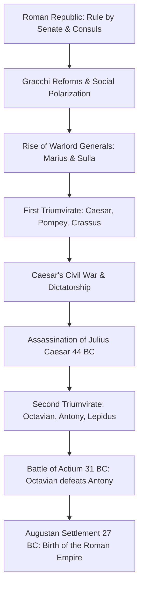
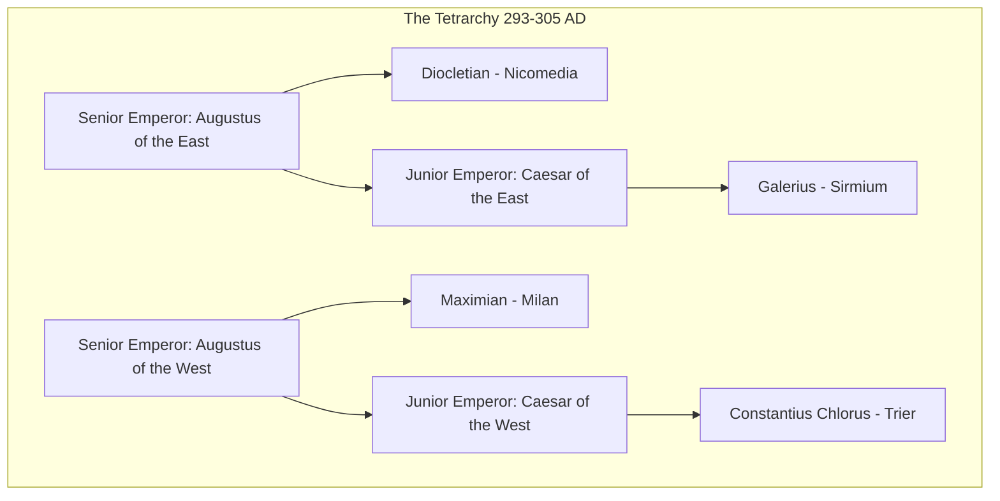
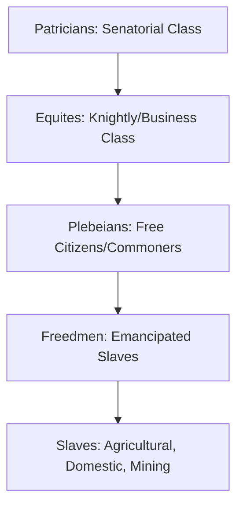

# 🏛️ The Roman Empire: An Exhaustive Historical and Structural Analysis

The Roman Empire (*Imperium Romanum*) remains one of the most powerful, influential, and enduring civilizations in human history. Spanning three continents—Europe, Asia, and Africa—at its territorial peak, Rome's administrative, legal, military, and cultural innovations laid the bedrock for Western civilization. 

This document provides a comprehensive, multi-dimensional analysis of the Roman Empire, detailing its political transitions, dynastic successions, military apparatus, socio-economic structures, technological achievements, and eventual fragmentation.

---

## 1. The Fall of the Republic and the Birth of the Empire

The transition from the Roman Republic to the Roman Empire was not a sudden event, but a century-long process of political decay, civil wars, and the centralization of military power in the hands of individual generals.



### 1.1. The Crisis of the Late Republic
The traditional republican constitution, designed for a city-state, proved inadequate for managing a vast Mediterranean empire. Key factors that destabilized the Republic included:
*   **The Marian Reforms (107 BC):** Gaius Marius allowed landless citizens into the army, transforming the legions into professional forces loyal to their generals (who promised land upon retirement) rather than to the Roman Senate.
*   **Social and Agrarian Polarization:** The influx of cheap slave labor from conquests decimated the Italian free peasantry, leading to the rise of massive slave-run estates (*latifundia*) and a disenfranchised urban mob in Rome.
*   **The Triumvirates:** Alliances of powerful men bypassed senatorial authority. Julius Caesar's crossing of the Rubicon in 49 BC precipitated the final civil wars that destroyed the republic's institutional framework.

### 1.2. The Augustan Settlement (27 BC)
Octavian, Julius Caesar’s adopted heir, emerged victorious from the civil wars. Understanding that Romans detested the title of king (*rex*), he established the **Principate**—a system where he retained absolute power under the modest title of ***Princeps* (First Citizen)**. He was granted the title **Augustus** (The Venerable) by the Senate, marking the official beginning of the Roman Empire.

---

## 2. Chronological Evolution: Dynasties and Eras

The imperial era is broadly divided into two main phases: the **Principate** (27 BC – 284 AD), characterized by the illusion of constitutional republican continuity, and the **Dominate** (284 – 476 AD/1453 AD), where the emperor ruled openly as an autocratic lord (*dominus*).

### 2.1. Comparison of the Two Imperial Eras

| Characteristic | The Principate (27 BC – 284 AD) | The Dominate (284 – 476/1453 AD) |
| :--- | :--- | :--- |
| **Imperial Title** | *Princeps* (First Citizen) | *Dominus et Deus* (Lord and God) |
| **Senate's Role** | Co-ruler in theory; legislative & judicial partner. | Mere municipal council of Rome/Constantinople; powerless. |
| **Succession Style** | Adoptive or dynastic; highly unstable. | Dynastic or military usurpation; heavily bureaucratic. |
| **Court Etiquette** | Access, informal; emperor wore citizen's toga. | Byzantine-style ritual; prostration (*adoratio*) required. |
| **Capital City** | Rome | Divided (Milan, Ravenna, Nicomedia, Constantinople). |
| **State Religion** | Roman Polytheism & Emperor Worship. | Nicene Christianity (post-Constantine). |

### 2.2. The Dynastic Sequences

#### 1. The Julio-Claudian Dynasty (27 BC – 68 AD)
*   **Emperors:** Augustus, Tiberius, Caligula, Claudius, Nero.
*   **Key Themes:** Consolidation of administrative structures, professionalization of the civil service, and increasing tension between the imperial palace and the old senatorial elite.
*   **Collapse:** Nero’s erratic behavior, financial extravagance, and poor military relations led to widespread rebellions, his suicide, and the first major civil war since Actium: **The Year of the Four Emperors (69 AD)** (Galba, Otho, Vitellius, and Vespasian).

#### 2. The Flavian Dynasty (69 – 96 AD)
*   **Emperors:** Vespasian, Titus, Domitian.
*   **Key Themes:** Fiscal stabilization, infrastructural rebuilding (construction of the **Flavian Amphitheater / Colosseum**), and military campaigns in Britain and Judea (Sack of Jerusalem in 70 AD).
*   **Collapse:** Domitian’s tyrannical, paranoid rule led to his assassination in a palace conspiracy.

#### 3. The Nerva-Antonine Dynasty & The Five Good Emperors (96 – 192 AD)
This era represents the peak of Roman power, territorial extent, and prosperity—a period famously described by historian Edward Gibbon as the time when "the condition of the human race was most happy and prosperous."
*   **Emperors:** Nerva, Trajan, Hadrian, Antoninus Pius, Marcus Aurelius, Commodus.
*   **The Adoptive System:** Except for Commodus, emperors selected their successors based on merit rather than biological relation, adopting them formally to guarantee a smooth transition of power.
*   **Territorial Peak:** Under **Trajan** (reigned 98–117 AD), the empire reached its greatest geographic extent, conquering Dacia, Armenia, and Mesopotamia.
*   **Hadrian's Consolidation:** Hadrian (reigned 117–138 AD) reversed the expansionist policy, focusing on securing the borders by constructing defensive fortifications like **Hadrian's Wall** in Britain.

```
       [Territorial Evolution of the Roman Empire]
       
       (27 BC)      (117 AD)                   (395 AD)          (476 AD)
       Augustus     Trajan                     Division          Fall of West
          |-----------|---------------------------|-----------------|
       Consolidation  Peak Expansion          East/West Split    Odoacer deposes
       of Empire     (Dacia, Mesopotamia)     (Arcadius/Honorius) Romulus Augustulus
```

#### 4. The Severan Dynasty (193 – 235 AD)
*   **Emperors:** Septimius Severus, Caracalla, Geta, Elagabalus, Severus Alexander.
*   **Key Themes:** Increasing militarization of the government ("Pay the soldiers, ignore everyone else" - Septimius Severus). In 212 AD, Caracalla issued the **Constitutio Antoniniana**, granting Roman citizenship to all free inhabitants of the empire, primarily to increase tax revenues.

#### 5. The Crisis of the Third Century (235 – 284 AD)
A fifty-year period of near-collapse, characterized by:
*   **Military Usurpation:** Over 26 different "soldier-emperors" claimed the throne, most dying violently.
*   **External Invasions:** Germanic tribes crossed the Rhine-Danube frontier; the newly established Sasanian Empire pressured the east.
*   **Economic Collapse:** Hyperinflation caused by the debasement of silver coinage, leading to a reversion to a barter economy.
*   **Secession:** The empire fractured into three competing states: the Gallic Empire, the Palmyrene Empire, and the central Roman Empire.
*   **Restoration:** **Aurelian** (reigned 270–275 AD) reconquered the breakaway regions, earning the title *Restitutor Orbis* (Restorer of the World).

---

## 3. The Late Empire: Diocletian, Constantine, and Division

Diocletian stabilized the empire by ending the Crisis of the Third Century, but at the cost of restructuring the Roman state into an autocratic, highly bureaucratic system.

### 3.1. Diocletian’s Tetrarchy (Rule of Four)
To manage a vast empire facing constant external threats, Diocletian split the administration between two senior emperors (**Augusti**) and two junior emperors (**Caesares**).



While the Tetrarchy collapsed into civil wars after Diocletian's retirement, the concept of dividing the administrative burdens of the empire permanently took root.

### 3.2. Constantine the Great and Christianization
*   **The Edict of Milan (313 AD):** Constantine and Licinius declared religious tolerance, ending the systematic persecution of Christians.
*   **Council of Nicaea (325 AD):** Constantine convened the first ecumenical council to resolve theological disputes (Arianism), binding the Roman state to Christian orthodoxy.
*   **New Rome / Constantinople:** Constantine moved the imperial capital from Rome to the strategically located Greek city of Byzantium on the Bosporus, renaming it Constantinople (dedicated in 330 AD).

### 3.3. Permanent Division and Fall (395 – 476 AD)
Following the death of Emperor Theodosius I in 395 AD, the empire was permanently divided between his sons: Arcadius in the East and Honorius in the West.

*   **The Western Roman Empire:** Suffered from economic stagnation, internal instability, and the mass migration of Germanic tribes (Vandals, Goths, Huns). Rome was sacked by the Visigoths in 410 AD and by the Vandals in 455 AD. In **476 AD**, the Germanic chieftain Odoacer deposed the last Western emperor, **Romulus Augustulus**, marking the traditional end of Western antiquity.
*   **The Eastern Roman (Byzantine) Empire:** Blessed with greater population density, wealth, and defensible borders, the Eastern Empire survived for another millennium, eventually falling to the Ottoman Turks in **1453 AD**.

---

## 4. Government, Administration, and Roman Law

The stability of the Roman Empire relied on a mixture of centralized authority, local municipal self-government, and a highly structured legal framework.

### 4.1. Provincial Administration
Provinces were divided into two main categories to balance power between the Emperor and the Senate:

1.  **Imperial Provinces:** Border provinces containing active military legions. They were governed directly by representatives of the Emperor called ***Legati Augusti pro praetore***.
2.  **Senatorial Provinces:** Secure, peaceful interior provinces (e.g., Achaea, Asia) governed by ***Proconsuls*** appointed by the Roman Senate.
3.  **Special Status (Egypt):** Egypt was treated as the private estate of the Emperor, managed by an equestrian Prefect. Senators were legally banned from visiting Egypt without express imperial permission to prevent them from cutting off Rome's grain supply.

### 4.2. Roman Law (*Ius Civile*)
One of Rome's most enduring contributions to global civilization was its systematized legal code. 

*   **Evolution of Law:** Developed from the early **Twelve Tables** (450 BC) of the Republic, Roman law evolved under the Empire through imperial edicts (*constitutiones*), senatorial decrees (*senatus consulta*), and juristic opinions.
*   **Key Legal Principles:**
    *   *Presumption of Innocence:* "The burden of proof lies on the accuser, not the accused" (*Ei incumbit probatio qui dicit, non qui negat*).
    *   *Equality before the Law:* Legal parameters applicable to all citizens, though distinctions remained between citizens and non-citizens, and later between the elite (*honestiores*) and the commoners (*humiliores*).
*   **Corpus Juris Civilis:** Compiled under the Eastern Emperor Justinian I in the 6th century AD, this compilation preserved Roman law and served as the direct basis for modern civil law systems in continental Europe, Latin America, and beyond.

---

## 5. Military Organization and Defense Strategy

The Roman army was a highly disciplined, professional fighting machine whose primary function transitioned from aggressive conquest during the Republic to defensive border maintenance under the Empire.

### 5.1. Structure of the Roman Legion (Principate Era)
A Roman legion was a highly standardized infantry force numbering approximately 5,120 soldiers, supported by cavalry and auxiliary units.

```
+-----------------------------------------------------------+
|                   ROMAN LEGION (~5,120 Men)              |
| Governed by a Legatus (Senatorial General)                |
+-----------------------------------------------------------+
                             |
         +-------------------+-------------------+
         |                                       |
+------------------+                    +------------------+
| Cohorts 2 to 10  |                    |    Cohort 1      |
| 480 men each     |                    | Double strength  |
| (6 Centuries)    |                    | 800 elite men    |
|                  |                    | (5 Centuries)    |
+------------------+                    +------------------+
         |
         +--> Divided into:
              * Centuries (80 men, commanded by a Centurion)
              * Contubernia (8 men sharing a tent and cooking gear)
```

*   **Legionaries:** Fully professional Roman citizens who enlisted for 20 to 25 years. They were armed with the iconic short sword (*gladius*), throwing javelins (*pila*), a curved rectangular shield (*scutum*), and segmented iron plate armor (*lorica segmentata*).
*   **Auxiliaries:** Non-citizens recruited from the provinces who provided specialized troops (Numidian cavalry, Cretan archers, Balearic slingers). Upon completing their service (typically 25 years), they and their descendants received full Roman citizenship.
*   **The Praetorian Guard:** An elite unit of 9,000 soldiers stationed in and around Rome, tasked with protecting the Emperor. They frequently acted as political kingmakers, assassinating emperors (such as Caligula and Pertinax) and selling the throne to the highest bidder.

### 5.2. Border Defense Policy (*Limes*)
The Roman defense system shifted from elastic offense to a static defensive perimeter called the ***limes***.
*   **Physical Walls:** E.g., Hadrian’s Wall (UK) and the Upper Germanic-Rhaetian Limes (Germany).
*   **Natural Frontiers:** Using large rivers like the Rhine and the Danube as natural barriers, reinforced by a chain of wooden or stone forts (*castra*) and watchtowers.
*   **Road Network:** A massive network of paved military roads enabled rapid deployment of troops from central garrisons to troubled borders.

---

## 6. Socio-Economic Structure and Daily Life

The Roman Empire was highly stratified, agrarian-based, and heavily reliant on slavery, yet it maintained a bustling, commercialized Mediterranean economy.

### 6.1. Social Hierarchy



*   **The Senatorial Class:** The wealthy elite who held major political and military offices. Entry required a minimum property qualification of 1,000,000 sesterces.
*   **The Equestrian Class (*Equites*):** The business and financial class. They filled bureaucratic positions like financial procurators and military prefects. Property qualification: 400,000 sesterces.
*   **Plebeians:** The working-class citizens. In Rome, they were kept content through the policy of ***panem et circenses*** (bread and circuses)—free grain distributions and state-sponsored entertainment (gladiatorial combat in the Colosseum and chariot races in the Circus Maximus).
*   **Slaves:** Property of their masters, with no legal rights. They worked in mines, agricultural fields, domestic services, and as educators. Slavery was not based on race, but on conquest, piracy, and debt.
*   **Freedmen (*Liberti*):** Emancipated slaves who gained citizenship but retained social stigma and patron-client obligations to their former masters.

### 6.2. Economy and Mediterranean Trade
The *Pax Romana* (Roman Peace) allowed maritime trade to flourish across the Mediterranean (*Mare Nostrum* - "Our Sea"), which was completely cleared of piracy.

*   **Agriculture:** The backbone of the economy, employing over 80% of the population. Main crops were wheat, olives, and grapes (the Mediterranean triad).
*   **Monetary System:** Based on the gold ***aureus***, silver ***denarius***, brass *sestertius*, and copper *as*. Standardized currency facilitated trade from Britain to India.
*   **Trade Routes:** Rome imported silk from China (via the Silk Road), spices from India, incense from Arabia, amber from the Baltic, and grain from Egypt and North Africa.

---

## 7. Roman Architecture, Engineering, and Technology

The Romans were pragmatic builders who adapted Greek designs and revolutionized construction through materials science and spatial design.

### 7.1. Key Technological Innovations

*   **Roman Concrete (*Opus Caementicium*):** Made by mixing volcanic ash (pozzolana) with lime and water. It could set under water, allowing the construction of massive harbors, bridges, and temples.
*   **The Arch and Vault:** Allowed builders to span large spaces and support immense weight, minimizing the need for columns.
*   **Aqueducts:** Elevated stone channels that carried water from distant mountain springs to urban centers using gravity alone. At its peak, the city of Rome had 11 aqueducts supplying over one million cubic meters of fresh water daily to public baths, fountains, and private homes.
*   **The Dome:** Exemplified by the **Pantheon** in Rome, completed under Hadrian. Its unreinforced concrete dome remains the largest in the world, utilizing volcanic tufa and pumice to reduce weight toward the center.
*   **Roman Roads:** Paved multi-layered highways constructed for military mobility and trade. Built straight across the landscape, they featured drainage ditches and milestones.

```
       [Cross-Section of a Roman Road]
       
       +---------------------------------------+  <- Pavimentum (Flat paving stones)
       |   o o o o o o o o o o o o o o o o o   |  <- Nucleus (Cement mixed with gravel)
       |=======================================|  <- Rudus (Crushed stone and lime)
       |.......................................|  <- Statumen (Large support stones)
       +---------------------------------------+  
```

---

## 8. Summary of Key Roman Emperors

The following table summarizes the reigns, dynasties, achievements, and failures of the most significant emperors of Rome:

| Emperor | Reign | Dynasty | Key Achievements | Failures & Downfall | Historical Significance |
| :--- | :--- | :--- | :--- | :--- | :--- |
| **Augustus** | 27 BC – 14 AD | Julio-Claudian | Initiated the *Pax Romana*; reorganized the tax system; established the Praetorian Guard. | Failed to establish a clear succession system; lost three legions in the Battle of the Teutoburg Forest. | Founder of the Roman Empire and its longest-reigning ruler. |
| **Tiberius** | 14 – 37 AD | Julio-Claudian | Consolidated the treasury; secured borders. | Abandoned Rome for Capri, leaving power to the tyrannical Sejanus. | Refined the administration of the early Principate. |
| **Caligula** | 37 – 41 AD | Julio-Claudian | Initially popular; recalled exiles. | Extreme extravagance, mental instability, claimed divinity. | Assassinated by the Praetorian Guard; showed the vulnerability of the autocracy. |
| **Claudius** | 41 – 54 AD | Julio-Claudian | Conquered Britain; built the harbor of Ostia; expanded the civil service. | Dominated by his wives and freedmen. | Proved that military conquest was still possible under the Principate. |
| **Nero** | 54 – 68 AD | Julio-Claudian | Rebuilt Rome after the Great Fire; patronized arts. | Prosecuted Christians; debased currency; executed senators. | Committed suicide; ended the Julio-Claudian line, sparking civil war. |
| **Vespasian** | 69 – 79 AD | Flavian | Rebuilt finances; began Colosseum; stabilized the state. | Imposed unpopular taxes (e.g., on urine). | Restored stability after the civil war of 69 AD. |
| **Trajan** | 98 – 117 AD | Nerva-Antonine | Conquered Dacia and Parthia; built Trajan's Forum; expanded welfare (*alimenta*). | Overextended military resources in Parthia. | Elevated Rome to its greatest territorial size; declared *Optimus Princeps*. |
| **Hadrian** | 117 – 138 AD | Nerva-Antonine | Reorganized civil law; built Hadrian's Wall and the Pantheon; promoted Greek culture. | Brutal suppression of the Bar Kokhba revolt in Judea. | Defined the defensive borders of the classic Empire. |
| **Marcus Aurelius**| 161 – 180 AD | Nerva-Antonine | Successfully defended borders against Marcomanni; wrote the Stoic classic *Meditations*. | Co-opted his unfit biological son Commodus as successor. | The last of the "Five Good Emperors"; the philosopher-king. |
| **Caracalla** | 198 – 217 AD | Severan | Built the Baths of Caracalla; issued citizenship to all free men (212 AD). | Assassinated his brother Geta; depleted treasury on army pay. | Irreversibly altered the legal and social definition of a Roman citizen. |
| **Diocletian** | 284 – 305 AD | Illyrian/Dominate | Established the Tetrarchy; stabilized economy; restructured the provinces. | Initiated the Great Persecution of Christians; price controls failed. | Ended the Third Century Crisis; began the Dominate era. |
| **Constantine I** | 306 – 337 AD | Constantinian | Legalized Christianity (313 AD); moved capital to Constantinople; unified the empire. | Executed his eldest son Crispus and wife Fausta. | The first Christian emperor; shifted the political focus of the West to the East. |
| **Theodosius I** | 379 – 395 AD | Theodosian | Made Nicene Christianity the official state religion; ended Olympic Games. | Allowed Visigoths to settle inside Roman borders as allies (*foederati*). | The last emperor to rule both the Eastern and Western halves. |
| **Romulus Augustulus**| 475 – 476 AD | Western Roman | None. | Deposed by the Germanic general Odoacer at age 14. | His deposition marks the traditional end of the Western Roman Empire. |

---

## 9. Theories on the Decline and Fall of Rome

The collapse of the Western Roman Empire has been debated by historians for centuries. Rather than a single catastrophic event, the fall is now viewed as a complex process of internal degradation compounded by external pressures.

### 9.1. Main Historiographical Theories

1.  **Military Overreach and Barbarian Invasions:** The migration of Germanic tribes (Goths, Vandals, Huns) fleeing climate changes and pressure from Central Asia. Rome's military, increasingly reliant on barbarian mercenaries (*foederati*), lacked the discipline and numbers to defend the frontiers.
2.  **Economic Decay and Fiscal Collapse:** Heavy taxation to support a massive army and bureaucracy depleted the middle class. Inflation, currency debasement, and trade disruptions created localized self-sufficient estates (*latifundia*), which withdrew from the imperial economy.
3.  **Religious Shift (Christianity):** Historians like Edward Gibbon argued that Christianity weakened the traditional Roman martial spirit by emphasizing the afterlife and pacifism, while diverting financial resources and intellectual talent to the church instead of public administration.
4.  **Political Instability:** The lack of a clear, institutionalized system for imperial succession led to constant civil wars, weakening the state from within and leaving borders exposed.

---

## 10. Glossary of Roman Political and Social Terms

*   **Aureus:** The standard Roman gold coin, used for large transactions and military payments.
*   **Augustus:** Imperial title meaning "majestic" or "venerable", first granted to Octavian and subsequently used by all senior Roman emperors.
*   **Caesar:** Originally the family name of Julius Caesar; it became an imperial title designating the junior heir to the throne under the Tetrarchy.
*   **Cursus Honorum:** The traditional sequence of public offices held by aspiring Roman politicians (Quaestor, Aedile, Praetor, Consul).
*   **Denarius:** The standard silver coin of the Roman Republic and early Empire; the daily wage of a common laborer or soldier.
*   **Dominus:** Meaning "Lord" or "Master", a term adopted by Late Roman emperors, reflecting the autocratic nature of the Dominate.
*   **Foederati:** Barbarian tribes allied with Rome, granted land within the empire in exchange for military service under their own commanders.
*   **Latifundia:** Large, slave-run agricultural estates that dominated Italian agriculture and pushed free farmers out of work.
*   **Limes:** The fortified frontier systems of the Roman Empire, combining physical walls, military camps, and natural geographic barriers.
*   **Pax Romana:** A 200-year period of relative internal peace and stability initiated by Augustus, lasting from 27 BC to 180 AD.
*   **Princeps:** Meaning "First Citizen"; the political title used by early emperors during the Principate to maintain the illusion of republican rule.
*   **Tetrarchy:** The administrative division of the Empire into four parts under Diocletian, ruled by two *Augusti* and two *Caesares*.

## 🔗 Suggested Connections
- [[🏛️ Biografía Exhaustiva de Sócrates: El Padre de la Filosofía Moral]] — High semantic similarity.
- [[🤖 The Evolution of Artificial Intelligence: From Symbolic Logic to Generative Foundations]] — High semantic similarity.
- [[gothic_architecture]] — High semantic similarity.
