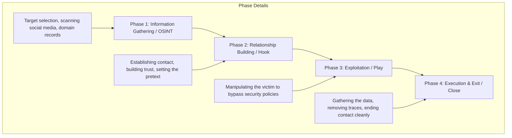
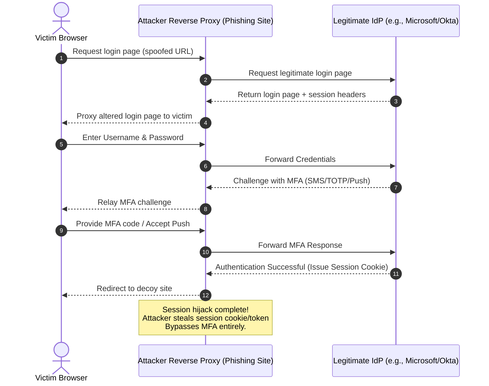
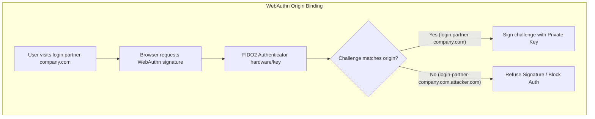
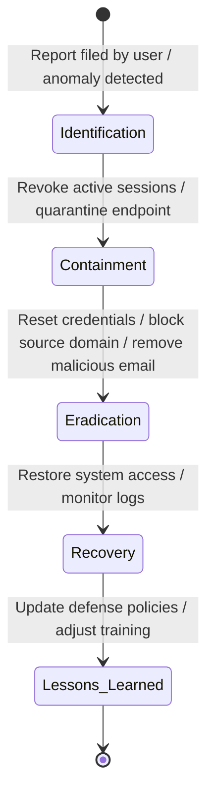

# 🛡️ Defensive Guide to Social Engineering: Principles, Taxonomy, and Organizational Mitigation

Social engineering is the act of manipulating individuals into performing actions or divesting confidential information. In the context of information security, it represents the exploitation of the "human element"—often considered the weakest link in a security perimeter. Unlike traditional cyberattacks that target software vulnerabilities or network misconfigurations, social engineering exploits cognitive biases, trust, and psychological triggers.

This document serves as a comprehensive, defense-oriented reference manual detailing the psychological mechanics, common attack vectors, lifecycle models, and technical/administrative controls required to protect an organization against social engineering threats.

---

## 1. The Psychology of Manipulation: Cialdini’s Principles and Cognitive Biases

At the core of every social engineering attack lies an exploitation of human psychology. Robert Cialdini, a professor of psychology and marketing, identified six key principles of influence that describe how humans make decisions. Attackers weaponize these principles to bypass logical scrutiny.

### 1.1. Cialdini's Principles of Influence

| Principle | Psychological Mechanism | Typical Attacker Exploitation | Defensive Countermeasure |
| :--- | :--- | :--- | :--- |
| **Authority** | Humans are conditioned to obey figures of authority (e.g., executives, law enforcement, IT admins). | Impersonating a CEO demanding urgent wire transfers or an external auditor demanding access. | Establish out-of-band verification protocols that bypass hierarchical pressure. |
| **Urgency / Scarcity** | People make impulsive decisions when they believe time or resources are limited. | "Your account will be suspended in 30 minutes if you do not verify your credentials." | Enforce a policy that bans time-sensitive demands for credentials or financial operations. |
| **Liking** | People are more likely to comply with requests from people they like or share commonalities with. | Gathering OSINT to build rapport, pretending to share mutual acquaintances or hobbies. | Training employees on the risks of sharing personal information on public platforms (OSINT hygiene). |
| **Reciprocity** | Humans feel an obligation to return favors or concessions. | Offering a helpful tip, troubleshooting help, or a small gift before requesting sensitive data. | Mandate that all technical support and information exchange adhere to strict ticketing flows. |
| **Social Proof / Consensus**| People look to the behavior of others to determine their own actions in unfamiliar situations. | "The rest of your department has already updated their portals; please do so as well." | Standardize communication channels so that system changes are announced globally and verified. |
| **Commitment & Consistency**| People desire to appear consistent with their previous statements or actions. | Getting a victim to agree to a small, harmless request first, then escalating to a sensitive one. | Define clear boundaries for data classification; small concessions should never lead to data release. |

### 1.2. Exploited Cognitive Biases
Beyond Cialdini's principles, attackers leverage innate cognitive shortcuts:
*   **Hyperbolic Discounting:** The tendency for people to choose immediate rewards (e.g., a fake prize) over long-term security considerations.
*   **Bystander Effect:** In organizational contexts, assuming "someone else must have verified this vendor" when executing a suspicious request.
*   **Optimism Bias:** The belief that "I am too smart to fall for a scam," which leads to reduced vigilance.

---

## 2. The Social Engineering Lifecycle

To implement effective detection mechanisms, security analysts must understand the chronological stages of a structured social engineering campaign. The industry-standard lifecycle consists of four distinct phases.



### 2.1. Phase 1: Information Gathering (OSINT)
The attacker collects as much information as possible about the target individual or organization.
*   **Sources utilized:** LinkedIn (corporate structure, technologies used), WHOIS records, public GitHub repositories (accidental API keys or internal hostnames), job postings (revealing specific software suites or database engines).
*   **Defensive Focus:** Data minimization policies, monitoring of public code repositories, and restricting public directories.

### 2.2. Phase 2: Relationship Building
The attacker establishes contact and builds trust using a prepared **pretext** (a fabricated scenario designed to make the interaction plausible).
*   **Pretext Examples:** Pretending to be an internal helpdesk technician, a new hire, an insurance adjuster, or a delivery driver.
*   **Defensive Focus:** Multi-factor identity verification protocols for all external and internal communications.

### 2.3. Phase 3: Exploitation
The core phase where the manipulation takes place. The attacker uses the established trust and psychological triggers to persuade the victim to act against policy.
*   **Actions demanded:** Clicking a link, downloading an attachment, revealing a password reset code, or authorizing a physical entry.
*   **Defensive Focus:** Endpoint protection tools, strict access control, and user awareness.

### 2.4. Phase 4: Execution and Exit
The attacker completes the action (e.g., retrieving the data or installing access vectors) and exits the interaction cleanly without raising suspicion, allowing them to maintain access.
*   **Exit tactics:** Faking a technical error, promising to follow up later, or deleting trace logs.
*   **Defensive Focus:** Forensic log analysis, immediate revocation of suspicious sessions, and post-incident reporting.

---

## 3. Taxonomy of Social Engineering Vectors

Social engineering attacks occur across multiple mediums. Understanding the taxonomy is critical for mapping controls to specific channels.

```
                   [Social Engineering Vectors]
                                |
         +----------------------+----------------------+
         |                                             |
   [Digital Vectors]                            [Physical Vectors]
         |                                             |
         +--> Phishing (Email)                         +--> Tailgating / Piggybacking
         +--> Spear Phishing (Targeted)                +--> Shoulder Surfing
         +--> Smishing (SMS)                           +--> Dumpster Diving
         +--> Vishing (Voice / Telephone)              +--> Baiting (USB Drop)
         +--> Watering Hole (Web Compromise)           +--> Impersonation (Badge cloning)
```

### 3.1. Digital and Communication Vectors

#### A. Phishing and Spear Phishing
Phishing is the mass distribution of fraudulent emails designed to steal credentials or deliver malware. **Spear Phishing** is a highly targeted version, customized using OSINT about the specific victim.
*   *Pretexting Mechanism:* Mimicking banks, corporate HR portals, or internal IT announcements.
*   *Mitigation:* Email authentication protocols (SPF, DKIM, DMARC) and browser-based anti-phishing protection.

#### B. Vishing (Voice Phishing)
Using phone systems to extract information. Attackers often spoof caller ID numbers to appear as internal support desks or government agencies.
*   *Pretexting Mechanism:* Faking an urgent IT emergency (e.g., "Your laptop is sending spam, I need your remote support access").
*   *Mitigation:* A strict policy stating that IT support will never ask for credentials or access codes over the phone without out-of-band validation.

#### C. Smishing (SMS Phishing)
Exploiting mobile messaging platforms to deliver malicious links.
*   *Pretexting Mechanism:* Mimicking shipping notifications or package delivery tracking links.
*   *Mitigation:* Mobile Device Management (MDM) filtering policies and employee education regarding mobile hygiene.

#### D. Watering Hole Attacks
Instead of targeting the victim directly, the attacker compromises a third-party website frequently visited by the target group (e.g., an industry news forum).
*   *Pretexting Mechanism:* Modifying the site to deliver drive-by downloads to specific IP ranges.
*   *Mitigation:* Network segmentation, web reputation filtering, and keeping client-side software patched.

### 3.2. Physical and Operational Vectors

#### A. Tailgating / Piggybacking
Following an authorized employee through a secure physical entrance without presenting credentials.
*   *Pretexting Mechanism:* Carrying large boxes or pretending to struggle with keys to exploit the victim's politeness.
*   *Mitigation:* Mantraps, turnstiles, badge-in requirements for exit, and a culture of challenging unbadged visitors.

#### B. Baiting (USB Drop)
Leaving malware-infected physical media (USB drives, external hard drives) in public areas (parking lots, cafeterias) where employees will find them.
*   *Pretexting Mechanism:* Labeling the USB drive with tempting titles (e.g., "Executive Salaries Q3" or "Confidential Layoff Plan").
*   *Mitigation:* Group Policy Objects (GPO) disabling USB autoplay/autorun, USB port blocking, and employee training.

---

## 4. Technical Mitigations: Email and Identity Architecture

While social engineering targets human psychology, technical controls act as a critical safety net, blocking or containing attacks before they reach users.

### 4.1. Email Authentication Frameworks
Attackers often spoof domain names to establish authority. Organizations must deploy three essential DNS records:

```
[Incoming Spoofed Email] 
         |
         v
  [1. SPF Check] ----> Verifies sending IP against allowed domain IPs (Fail = Reject/Quarantine)
         |
         v
  [2. DKIM Check] ---> Verifies cryptographic signature in email header (Fail = Untrusted)
         |
         v
  [3. DMARC Policy] -> Directs receiving server what to do with failures (None, Quarantine, Reject)
```

1.  **SPF (Sender Policy Framework):** Specifies which IP addresses are authorized to send email on behalf of a domain.
    *   *Sample Record:* `v=spf1 ip4:192.168.1.0/24 include:_spf.google.com -all` (The `-all` indicates hard fail for unauthorized IPs).
2.  **DKIM (DomainKeys Identified Mail):** Cryptographically signs outgoing emails, verifying that the email header and body have not been altered in transit.
3.  **DMARC (Domain-based Message Authentication, Reporting, and Conformance):** Tells receiving mail servers how to handle emails that fail SPF or DKIM checks.
    *   *Sample Record:* `v=DMARC1; p=reject; rua=mailto:dmarc-reports@example.com` (Instructs receiving servers to reject non-compliant emails and send reports).

### 4.2. Reverse Proxy Phishing (Adversary-in-the-Middle)
Standard MFA methods like SMS, TOTP codes (Google Authenticator), or push notifications are highly vulnerable to **Adversary-in-the-Middle (AiTM)** or **Reverse Proxy Phishing** toolkits (e.g., Evilginx, Muraena). 

Instead of host-based credential harvesting, the proxy phisher acts as a dynamic middleman between the victim and the legitimate identity provider (IdP).



*   **The Session Hijack:** Because the proxy intercepts traffic at the HTTP layer, it intercepts the server's response headers, including the **session cookies (Session Tokens)**. The attacker copies these cookies into their own browser, completely bypassing the username, password, and MFA validation stages for future access.

---

### 4.3. Phishing-Resistant MFA: FIDO2 & WebAuthn Configuration
To mitigate AiTM proxy attacks, organizations must enforce authentication methods that bind the credential to the specific web domain. **FIDO2** and **WebAuthn** (Web Cryptography API) achieve this through public-key cryptography.



#### A. The Cryptographic Registration Protocol
1.  **Challenge Generation:** The server sends a unique challenge, the user's ID, and the relying party ID (`RP ID`, matching the legitimate domain, e.g., `login.company.com`) to the client browser.
2.  **Key Pair Creation:** The browser calls the WebAuthn API `navigator.credentials.create()`. The hardware authenticator (e.g., YubiKey) prompts user presence (touch/PIN) and creates a new cryptographic key pair specific to that domain.
3.  **Origin Binding:** The public key, a credential ID, and an attestation signature are returned to the server. The authenticator **permanently binds the private key** to the `RP ID` (the domain).

#### B. The Authentication and Verification Process
1.  **Challenge Request:** When logging in, the server sends a random challenge to the browser.
2.  **Credential Check:** The browser calls `navigator.credentials.get()`. The browser automatically retrieves the actual domain URL (origin) from the address bar and passes it to the authenticator.
3.  **The Anti-Phishing Guard:** Even if a user is tricked by a phishing site (`login-company.com.attacker.com`) and attempts to authenticate, the browser sends this spoofed origin to the authenticator. The authenticator looks up its database and finds that it has no key pair registered for `login-company.com.attacker.com`, or it refuses to sign the challenge with the key belonging to the legitimate domain (`login.company.com`). The authentication fails automatically without user intervention.

---

### 4.4. Identity and Access Management (IAM) Controls
*   **Least Privilege Access Policy:** Minimizes the potential damage if a user account is compromised. Employees should only have access to the data required for their specific role.
*   **Conditional Access Policies:** Restricting authentication attempts based on device compliance, geographic location, and network origin. Device-bound certificates should be required to access cloud infrastructure.

---

## 5. Administrative and Physical Controls

Administrative policies define the boundaries of acceptable behavior, removing the ambiguity that social engineers exploit.

### 5.1. Policy Framework Matrix

| Policy Category | Focus Area | Mandated Procedure | Defensive Purpose |
| :--- | :--- | :--- | :--- |
| **Identity Verification Policy** | Phone and chat interactions. | Internal users requesting password resets must prove identity via an out-of-band MFA push notification. | Stops attackers from using vishing to hijack accounts via helpdesk staff. |
| **Financial Sign-off Policy** | Wire transfers, purchasing, account modifications. | Double-signature requirement with telephone confirmation using a pre-registered number. | Prevents CEO Fraud / Business Email Compromise (BEC). |
| **Data Classification Policy** | Information sharing boundaries. | Categorizes data into Public, Internal, Confidential, and Restricted. Sets sharing protocols. | Prevents accidental information disclosure during OSINT phases. |
| **Physical Visitor Management**| Facilities security. | All guests must be registered, escorted by an employee, and wear a highly visible visitor badge. | Mitigates tailgating, physical intrusion, and credential harvesting. |

---

## 6. Developing an Organizational Security Culture

A security-conscious culture transforms employees from passive targets into active security sensors.

### 6.1. Design Principles for Security Awareness Training
*   **Continuous, Micro-Learning Modules:** Annual training sessions are ineffective. Organizations should implement monthly, bite-sized training modules that highlight active real-world pretexts.
*   **Blame-Free Reporting Culture:** If an employee clicks a link in a phishing test or a real email, they should not be punished. Fear of punishment encourages concealment. A simple, one-click "Report Phishing" button in the email client should be provided and rewarded.
*   **Realistic Phishing Simulations:** Run regular simulations utilizing common templates and channels (SMS, Email). The metrics collected (Click rate, Reporting rate) must be monitored over time to measure improvement.

---

## 7. Comparative Matrix of Social Engineering Attack and Defense

The following matrix provides a quick reference comparing attack vectors, their execution methods, and the corresponding layers of defense:

| Attack Vector | Primary Communication Channel | Exploited Psychological Trigger | Key Technical Control | Key Human Defense |
| :--- | :--- | :--- | :--- | :--- |
| **Spear Phishing** | Email | Authority / Urgency | DMARC (Reject), External Sender Banners, Email Sandboxing | Verification of sender address and domain signature. |
| **CEO Fraud / BEC** | Email / Phone | Authority / Fear of reprisal | Strict payment gateway controls, anomaly detection engines | Verification using an out-of-band phone call. |
| **Tech Support Vishing**| Phone | Reciprocity / Helpfulness | Helpdesk ticketing verification tools, MFA challenge-response | Verification of callers via corporate directory lookup. |
| **MFA Fatigue / Push Bombing**| Authenticator Apps | Urgency / Cognitive fatigue | Number matching MFA, rate-limiting on authentication requests | Policy of immediately reporting unauthorized push prompts. |
| **Credential Harvesting Portal**| Web Browser | Trust / Consensus | Browser protection lists, FIDO2/WebAuthn hardware MFA | Examining the URL address bar; avoiding unverified links. |
| **Tailgating** | Physical Entrance | Politeness / Social conformity | Mantraps, physical turnstiles, security guards | Challenging unknown visitors to present badges. |
| **Watering Hole** | Compromised Web Forums | Liking / Trust | Web application firewalls, active patching of browser exploits | Restricting browsing to verified corporate networks. |

---

## 8. Incident Response Protocol for Social Engineering Compromise

When a social engineering breach is identified, organizations must respond rapidly to contain the threat and prevent lateral movement.



### 8.1. Incident Response Stages

#### 1. Identification
*   A user reports entering credentials on a suspicious page, or security operations center (SOC) logs detect anomalous access patterns (e.g., impossible travel logins).
*   *Key Action:* Log the incident details and verify the scope of the potential compromise.

#### 2. Containment
*   **Revoke Sessions:** Immediately terminate all active sessions for the compromised user account across the cloud identity provider (e.g., Azure AD, Okta).
*   **Quarantine Host:** If malware was downloaded, isolate the host computer from the network using Endpoint Detection and Response (EDR) software.
*   *Key Action:* Mitigate lateral movement of the attacker.

#### 3. Eradication
*   **Credential Reset:** Force a password reset for the affected user and verify that no unauthorized MFA devices or recovery methods were registered by the attacker.
*   **Purge Emails:** Remove the malicious phishing email from all user mailboxes using inbox searches.
*   *Key Action:* Remove the attacker's foothold.

#### 4. Recovery
*   Verify system integrity, restore access to quarantined machines, and return to normal operations.
*   *Key Action:* Monitor system access logs closely for any signs of residual access.

#### 5. Lessons Learned
*   Review how the attacker bypassed current technical controls, and update email filters or physical access policies.
*   Use the incident (anonymized) to update employee training programs.

---

## 9. Glossary of Defensive and Attack Terminology

*   **1-MCP (Concept comparison):** In physical security and social engineering defense, refers to freezing access permissions or locking down assets (similar to 1-MCP freezing cellular changes) during active incident response.
*   **Any (Zero Trust Context):** The policy of treating *any* incoming request, message, or identity as untrusted until cryptographically verified.
*   **Aporía (Context):** A state of uncertainty in a victim where contradictory pretexts from the attacker leave them confused and more likely to comply with instructions to resolve the stress.
*   **Aposematism (Defensive Context):** High-visibility warnings placed on external emails (e.g., "[EXTERNAL]" tags in the subject line) to warn users of potential danger.
*   **Baiting:** An attack vector that uses physical media or digital downloads labeled with tempting names to trick victims into executing malware.
*   **Business Email Compromise (BEC):** A highly targeted form of spear phishing where the attacker impersonates a senior executive to trick financial staff into authorizing fraudulent wire transfers.
*   **DMARC:** A framework for reporting and validating email conformity, instructing mail servers how to handle failures of SPF and DKIM.
*   **Dumpster Diving:** Searching through discarded trash to harvest sensitive documents, invoices, or utility bills for use in OSINT phases.
*   **FIDO2 / WebAuthn:** An open authentication standard that uses public-key cryptography to provide phishing-resistant multi-factor authentication.
*   **Mayéutica (Context):** Socratic-style guided auditing, used in security training to help employees identify phishing indicators on their own rather than simply memorizing rules.
*   **Nothing (Zero Trust Context):** The fundamental rule of access control: grant *nothing* beyond the minimum permissions necessary for the user's role (least privilege).
*   **OSINT (Open Source Intelligence):** The collection and analysis of publicly available information to identify targets and build plausible pretexts.
*   **Pretext:** The fictional backstory developed by a social engineer to establish trust and explain the context of their requests.
*   **Shoulder Surfing:** Observing a victim's screen or keyboard input (e.g., passwords, PINs) from a physical distance.
*   **Watering Hole Attack:** A cyberattack target strategy where the attacker infects websites frequented by targeted organization members to gain network access.

## 🔗 Suggested Connections
- [[🤖 The Evolution of Artificial Intelligence: From Symbolic Logic to Generative Foundations]] — High semantic similarity.
- [[🏛️ Biografía Exhaustiva de Sócrates: El Padre de la Filosofía Moral]] — High semantic similarity.
- [[🏛️ Guía Completa y Exhaustiva de Tipos de Arquitectura de Software]] — High semantic similarity.
